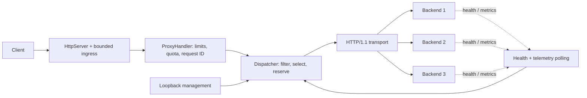
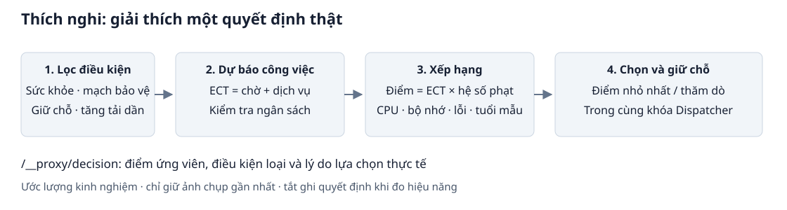

# Reverse Proxy & Adaptive Load Balancer — PBL4

Reverse proxy HTTP/1.1 viết bằng **Java 21, chỉ dùng thư viện JDK**. Đồ án nghiên cứu cách phân phối request khi độ trễ, lượng công việc và tài nguyên backend thay đổi; so sánh **Round Robin, Least Connections và Adaptive** bằng benchmark có thể tái hiện. Phạm vi dành cho PBL4 3 tín chỉ, chưa phải proxy production.

[Chạy demo](docs/DEMO.md) · [Adaptive](docs/ADAPTIVE_EXPLAINED.md) · [Phân tích hiệu năng](docs/PERFORMANCE_ANALYSIS.md) · [Report offline](docs/assets/charts/mixed-20261021/index.html) · [Codebase review](docs/CODEBASE_REVIEW.md)

## Bài toán và mục tiêu

Chia đều số request chưa chắc chia đều công việc: slow giữ slot lâu hơn light, còn backend ít connection có thể đang bận CPU. Proxy cung cấp một địa chỉ chung, phát hiện lỗi và chọn nơi xử lý phù hợp hơn.

Đồ án tập trung vào HTTP/concurrency đúng, quyết định Adaptive giải thích được và phép đo có cả thành công, lỗi, fairness giữa loại request. Hai thuật toán đơn giản được giữ làm đối chứng.

## Tính năng chính

- HTTP/1.1 buffered reverse proxy, request ID và error JSON.
- Round Robin, Least Connections, Adaptive theo estimated completion time (ECT).
- Health check, telemetry freshness và slow start khi hồi phục.
- Circuit breaker từng backend; token bucket theo peer IP có giới hạn bộ nhớ.
- Deadline xuyên suốt, bounded ingress, giới hạn in-flight/body/header và graceful shutdown.
- JSON/Prometheus metrics, management listener loopback tùy chọn.
- Snapshot giải thích Adaptive; backend fixture và Request Studio có sẵn.
- Benchmark seed/repeat/checksum/validator; report offline và chart SVG/PNG từ CSV thật.

## Kiến trúc



Dispatcher giữ một khóa cho selection/reservation/completion; không giữ khóa khi I/O. Lease trả in-flight/estimated work đúng một lần; generation chống completion cũ làm sai state mới. Mỗi upstream exchange dùng một socket với `Connection: close`; chưa có pooling hoặc retry. [Chi tiết kiến trúc](docs/ARCHITECTURE.md).

## Ba thuật toán và giá trị của Adaptive

| Thuật toán | Cách chọn | Trade-off |
|---|---|---|
| Round Robin | Xoay vòng backend đủ điều kiện | Không biết request nặng/nhẹ |
| Least Connections | Ít lease in-flight nhất, phá hòa theo lần chọn cũ nhất | Count không phản ánh service cost |
| Adaptive | Work admission, sau đó min ECT × penalty; có exploration | Ước lượng có sai số, chưa bảo đảm fairness |

```text
service = routeServicePerUnit × requestUnits
ECT = estimatedSlotWait + service
ranking = ECT × resourcePenalty
budget = min(readTimeout, requestTimeout)
```

Adaptive học service EWMA theo route, mô phỏng công việc còn lại trên các slot và kết hợp CPU/heap/error/freshness. Hai backend cùng số connection nhưng công việc khác nhau có thể được xếp hạng khác. Backend đồng nhất/ít tải có thể không hưởng lợi; request chậm có thể bị từ chối nhiều hơn. [Công thức và trace](docs/ADAPTIVE_EXPLAINED.md).



## Yêu cầu và cách chạy

JDK **21** với `java`, `javac`, `jar` trong PATH; Python 3.11+ cho benchmark. Maven tùy chọn; Java app/test không cần dependency ngoài. Chỉ tạo chart cần [Matplotlib](tools/requirements-charts.txt). Có script PowerShell và Bash.

```powershell
git clone https://github.com/nguyenvanquanghjhj/reverse-proxy.git
cd reverse-proxy
java -version
javac -version
powershell -ExecutionPolicy Bypass -File scripts/build.ps1
powershell -ExecutionPolicy Bypass -File scripts/demo.ps1 start -BindHost 127.0.0.1
```

Mở `http://127.0.0.1:8080/demo`; backend riêng có `/demo` ở 9001/9002/9003. [Bốn demo A/B/C/D và cách chạy LAN](docs/DEMO.md).

```powershell
curl.exe "http://127.0.0.1:8080/work?cost=1"
curl.exe http://127.0.0.1:8080/__proxy/health
curl.exe http://127.0.0.1:8080/__proxy/metrics
curl.exe http://127.0.0.1:8080/__proxy/prometheus
powershell -ExecutionPolicy Bypass -File scripts/demo.ps1 stop
```

Sau khi dừng demo, có thể chạy thủ công bằng hai terminal:

```powershell
# Terminal 1
powershell -ExecutionPolicy Bypass -File scripts/run-backends.ps1 -NoBuild
# Terminal 2
powershell -ExecutionPolicy Bypass -File scripts/run-proxy.ps1 -NoBuild
```

Linux/macOS/WSL: `bash scripts/build.sh`, rồi `bash scripts/run-backends.sh --no-build` và `bash scripts/run-proxy.sh --no-build`. Chạy trực tiếp:

```text
java -cp target/classes com.example.backend.DemoBackendServer 9001 8 20 0
java -jar target/reverse-proxy-demo.jar config/application.properties
```

## Cấu hình và observability

Sửa [application.properties](config/application.properties), restart proxy. `backend.servers=host:port:capacity`; capacity là concurrency, không phải trọng số.

| Key | Mặc định / vai trò |
|---|---|
| loadbalancer.strategy | ADAPTIVE; hỗ trợ ROUND_ROBIN, LEAST_CONNECTIONS |
| proxy.circuit-breaker.enabled | true |
| proxy.rate-limit.enabled | false |
| proxy.management.enabled | false; nếu bật chỉ bind 127.0.0.1:9090 |
| adaptive.decision-trace.enabled | false; chỉ giữ quyết định Adaptive mới nhất |
| proxy.connection-pool.enabled | false; true bị reject vì chưa triển khai |
| proxy.request.timeout.ms | 5000; deadline xuyên suốt ingress/upload/upstream/downstream |
| proxy.read.timeout.ms / proxy.connect.timeout.ms | 3000 / 500; timeout I/O upstream |

Bật tracing, gửi request rồi đọc `/__proxy/decision` để thấy candidate score, backend bị loại và reason minimum/exploration. Không lưu query/client ID. Trace tắt lúc đo.

Metrics/decision/health chỉ nhận loopback, kể cả data listener mở LAN. Đây là snapshot, không phải dashboard realtime. `scoreMs` là score RTT/count cũ; điểm request-specific là `rankingScoreMs` trong trace. In-flight là lease, không phải mọi TCP connection; process CPU/heap không phải CPU/RAM riêng của máy. [Metrics reference](docs/METRICS_REFERENCE.md).

## Test và benchmark

```powershell
powershell -ExecutionPolicy Bypass -File scripts/test.ps1
python -m unittest discover -s scripts -p "test_*.py"

# Smoke pipeline, không dùng kết luận thắng/thua
python scripts/benchmark.py --java "$env:JAVA_HOME/bin/java.exe" --quick --scenarios mixed --output benchmarks/results/my-smoke
python scripts/verify_benchmark.py benchmarks/results/my-smoke

# Ba repeats, cùng lịch gửi cho ba strategy
python scripts/benchmark.py --java "$env:JAVA_HOME/bin/java.exe" --requests 1200 --warmup-requests 300 --rate 60 --concurrency 64 --seed 20260927 --repeats 3 --scenarios mixed --output benchmarks/results/my-mixed
python scripts/verify_benchmark.py benchmarks/results/my-mixed
```

Đặt `JAVA_HOME` tới JDK 21. Benchmark biên dịch frozen snapshot, không dùng class IDE. Output phải là thư mục mới, có raw requests, telemetry, config, seed/hash và manifest. TestSuite chạy mọi test main trong JVM riêng, assertions bật, timeout 60 giây/suite. Maven tùy chọn: `mvn -B -ntp clean verify` dùng cùng TestSuite; Surefire tắt có chủ đích.

[BENCHMARK_GUIDE](docs/BENCHMARK_GUIDE.md) giải thích cách đo/đọc kết quả; [BENCHMARK](docs/BENCHMARK.md) mô tả schema. `benchmark_resilience.py` kiểm chứng behavior circuit/rate, không xếp hạng throughput.

## Kết quả và visualization

Mixed 21/10/2026: ba backend 4 slot/20ms; 60% light / 10% slow / 30% CPU; 60 RPS; 1200 đo + 300 warmup/run; 3 repeats/strategy. Counts cộng ba repeats; RPS/latency là median thống kê từng run, không phải pooled percentile.

<!-- PERFORMANCE_TABLE_START -->
| Algorithm | Total | Success | Failed | Success RPS | Error % | Avg ms | p50 ms | p95 ms | p99 ms |
|---|---|---|---|---|---|---|---|---|---|
| Round Robin | 3600 | 2139 | 1461 | 31.82 | 40.58 | 924.59 | 715.28 | 2,356.61 | 2,868.21 |
| Least Connections | 3600 | 2507 | 1093 | 37.68 | 30.36 | 964.21 | 890.13 | 2,568.29 | 3,132.02 |
| Adaptive | 3600 | 2668 | 932 | 37.25 | 25.89 | 518.31 | 58.25 | 2,036.92 | 2,638.75 |
<!-- PERFORMANCE_TABLE_END -->


Adaptive có ít lỗi tổng hơn nhưng median RPS không vượt LC, và slow lỗi 55,83% so với LC 47,78%. Đọc throughput cùng error và breakdown slow; không chỉ nhìn successful latency. [Phân tích và range](docs/PERFORMANCE_ANALYSIS.md).

Mở [report offline](docs/assets/charts/mixed-20261021/index.html) sau khi clone. Trên GitHub xem [bảng tổng](docs/assets/charts/mixed-20261021/overall-summary.md), [outcomes](docs/assets/charts/mixed-20261021/outcomes.svg), [latency](docs/assets/charts/mixed-20261021/latency.svg), [errors](docs/assets/charts/mixed-20261021/errors.svg), [backend distribution](docs/assets/charts/mixed-20261021/backends.svg).

```powershell
python -m pip install -r tools/requirements-charts.txt
python tools/generate_charts.py --bundle benchmarks/presentation/mixed-20261021 --output target/presentation-preview
```

Bundle CSV/provenance có trong Git; full raw artifact giữ riêng ở results. [VISUALIZATION_GUIDE](docs/VISUALIZATION_GUIDE.md) hướng dẫn tái tạo chart/report, không cần JVM đang chạy và không thay UI demo.

## Cấu trúc project

```text
src/main/java/com/example/
  proxy/config, backend/       Cấu hình và backend identity
  proxy/loadbalancer/          RR, LC, ECT, lease, circuit, decision trace
  proxy/metrics, healthcheck/  EWMA, telemetry, health/recovery
  proxy/handler, server/       HTTP transport, quota, deadline, lifecycle
  backend/                    Backend fixture và Request Studio có sẵn
src/test/java/                Plain Java test mains và runner timeout
scripts/                      Build/run/demo/benchmark/validator/Python tests
tools/                        Sinh chart, requirements tùy chọn
benchmarks/presentation/      CSV bundle/provenance có trong Git
benchmarks/results/           Full experiment artifacts, ignored
docs/                         Review, thiết kế, metrics, guides, phân tích
docs/assets/charts/           Report offline, SVG/PNG, summary tables
```

## Giới hạn và hướng phát triển

HTTP/1.1 buffered, một socket/request; chưa pooling, retry/failover, TLS termination, HTTP/2, WebSocket hoặc discovery động. Backend/control là fixture demo. Loopback management không thay TLS/auth/network policy khi triển khai thật.

ECT phụ thuộc prior, route metadata và telemetry lag; chưa bảo đảm fairness slow. Các JVM dùng chung host nên CPU/GC/client lag ảnh hưởng phép đo. Cần nhiều mức tải, nhiều host và sensitivity analysis trước khi suy rộng.

Hướng tiếp theo: thí nghiệm fairness có kiểm soát; hiệu chuẩn service estimate; pooling với test framing/lifecycle riêng; đo phân tán và dashboard history nếu phạm vi cho phép. Đây là hướng phát triển, chưa phải tính năng hiện có.

## Đóng góp và license

Tác giả và lịch sử đóng góp: [GitHub contributors](https://github.com/nguyenvanquanghjhj/reverse-proxy/graphs/contributors). Danh sách thành viên nhóm học phần chưa khai báo riêng trong repo. Hiện chưa có file LICENSE; chưa công bố giấy phép mã nguồn mở cụ thể.
