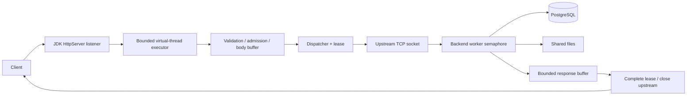

# PBL4 — Reverse Proxy và Load Balancing

Java 21 reverse proxy, ba backend Java, PostgreSQL và shared storage. Mộc Store là workload có transaction thật để nghiên cứu HTTP, concurrency, quá tải và lỗi. Phạm vi không mở rộng voucher, review, IMEI, bảo hành, POS, nhân viên hay thanh toán trực tuyến.

## Final Acceptance — 07/11/2026

[Báo cáo nghiệm thu tổng hợp duy nhất](../final-acceptance-20261107/report.html) ghi PASS / FAIL / NOT RUN, lệnh tái hiện và đường dẫn raw CSV/JSON/screenshot. Đây là lần chạy mới từ source hiện tại; các số liệu V7 phía dưới là lịch sử.

Clean build và 19 test mains PASS; 262 kiểm tra chức năng, 31 kiểm tra PDF/dependency/metrics, 12 ca HTTP raw trên `:8080`; 108 lượt so sánh ba thuật toán và 9 lần failure/recovery, mỗi điều kiện ba repeat. Không đổi Java ứng dụng hoặc hệ số thuật toán trong nghiệm thu. Đã sửa race trong fixture kiểm thử header và chạy lại suite cùng ba lượt riêng.

Cold start theo README mất 86,6 giây, giữ nguyên dữ liệu. Browser thật kiểm tra 12 mẫu/21 ảnh qua ba backend; tạo và giữ lại **một đơn COD QA**, trừ đúng một sản phẩm, không xóa/sửa lịch sử cũ. SQL và SHA-256 được đối chiếu trong báo cáo. Mất JDBC riêng B2 không làm B1/B3 chết; proxy chưa có capability routing nên request DB đến B2 vẫn có thể trả 503.

Chỉ nghiệm thu loopback một máy. LAN, máy mới/người chạy độc lập, PostgreSQL crash, đĩa đầy và mất điện: **NOT RUN**. Mặc định PDF bulkhead vẫn OFF. Raw evidence ở thư mục kế bên project; source vẫn chỉ có một README.


## Chạy trên Windows

Cần JDK **21** trên PATH và Python 3.12. `scripts/java21.ps1` kiểm tra phiên bản JDK đang được chọn, không tự cài/chuyển JDK. JDBC và PostgreSQL portable đã có trên máy này; máy mới cần mạng ở lần chuẩn bị đầu.

```powershell
powershell -NoProfile -ExecutionPolicy Bypass -File scripts/run.ps1 start
powershell -NoProfile -ExecutionPolicy Bypass -File scripts/run.ps1 status
```

- Cửa hàng: http://127.0.0.1:8080/shop
- Admin: http://127.0.0.1:8080/admin
- Dashboard: http://127.0.0.1:8080/__proxy/dashboard
- Thông tin đăng nhập: `.shop/admin-access.txt`. Cấu hình riêng: `.env.store`. Không đưa hai tệp này lên Git.

Lần đầu tạo database demo riêng trên `127.0.0.1:55434`, migrate V001–V005, seed catalog thật và tạo mật khẩu admin ngẫu nhiên. Các lần sau giữ dữ liệu, không tự seed/reset. `pg_ctl status` trong restricted token có thể không đọc được process; wrapper kiểm tra thêm [PostgreSQL SSLRequest](https://www.postgresql.org/docs/16/protocol-flow.html#PROTOCOL-FLOW-SSL) rồi vẫn xác thực JDBC/schema. Stop/start PostgreSQL ngoài restricted token được dùng trong tổng duyệt ở Codex; dữ liệu giữ nguyên.

`start` trên phiên đang chạy chỉ kiểm tra readiness; không rebuild bên dưới JVM đang dùng classes. Build từ chối thay classes khi còn JVM thuộc phiên demo. Không build trong khi chạy QA/benchmark riêng.

```powershell
python scripts/store.py stop                   # Chỉ dừng JVM, giữ PostgreSQL
powershell -ExecutionPolicy Bypass -File scripts/test.ps1
python scripts/store.py start --strategy ADAPTIVE
python scripts/store.py dependencies
python scripts/store.py drain --backend 9001
python scripts/store.py resume --backend 9001
python scripts/store.py audit
powershell -ExecutionPolicy Bypass -File scripts/run.ps1 stop  # Dừng cả database demo
```

Nếu nâng cấp database catalog concept cũ: dừng các writer, sao lưu, chạy `python scripts/store.py migrate`, `python scripts/store.py catalog`, `python scripts/store.py audit`, rồi `python scripts/store.py start`. Lệnh catalog chỉ đổi các mẫu seed nhận diện được; bỏ qua sản phẩm đã tùy biến, giữ ID/giá/tồn kho/snapshot đơn và mọi tệp cũ. Không tạo lại database. Database cũ hơn ở `.shop/legacy-postgres` được giữ riêng.

## Kiến trúc và vòng đời request



[Main](src/main/java/com/example/proxy/Main.java) cài listener policy **trước** khi tạo HttpServer. [ProxyHandler](src/main/java/com/example/proxy/handler/ProxyHandler.java) kiểm tra request và cấp admission; [Dispatcher](src/main/java/com/example/proxy/loadbalancer/Dispatcher.java) chọn backend, tạo lease dưới `ReentrantLock`. I/O diễn ra ngoài lock. [UpstreamTransport](src/main/java/com/example/proxy/handler/UpstreamTransport.java) mở một socket cho mỗi exchange, đọc response có giới hạn, đóng socket trong `finally`. Lease hoàn tất khi response upstream đã được buffer; lỗi ghi về client sau đó không được ghi thêm thành lỗi backend.

Phân biệt: TCP connection có thể chưa gửi HTTP; ingress task có thể đang parse header; handler đã nhận exchange; admission là phép xử lý ứng dụng; lease là công việc upstream mà scheduler đang theo dõi. LC ở đây đếm **lease in-flight**, không đếm mọi TCP connection. Health/telemetry dùng HttpClient riêng, không nằm trong counter socket exchange dữ liệu.

## Hợp đồng HTTP và các lỗi đã sửa

Không tuyên bố hỗ trợ toàn bộ HTTP/1.1. Listener/parser request thuộc JDK; parser response và transport do dự án triển khai. Chỉ chuyển tiếp origin-form; không có CONNECT tunnel, Upgrade/WebSocket, HTTP/2, TLS termination, streaming response hoặc connection pool upstream.

| Trường hợp | Hành vi trong phạm vi kiểm thử |
|---|---|
| GET, POST có/không body, HEAD | Chuyển tiếp body có giới hạn; HEAD không gửi response body |
| Phương thức `head` khác `HEAD` | Giữ ngữ nghĩa phân biệt hoa/thường, không tự bỏ body |
| HTTP/1.1 thiếu/trùng/Host sai cú pháp | 400, không cấp lease; HTTP/1.0 có thể thiếu Host |
| TE + CL; CL trùng/sai; TE ngoài chunked | 400; không chọn framing tùy tiện |
| Request chunked hợp lệ | Đọc body hữu hạn rồi chuyển tiếp với framing chuẩn hóa |
| Request bị cắt / quá body limit | 400 / 413 |
| Header vượt giới hạn ứng dụng | 431; lỗi bị listener từ chối sớm có thể là JDK 400/đóng kết nối |
| Response bị cắt / malformed / vượt giới hạn | 502; giải phóng socket và lease |
| Upstream timeout | 504; không retry tự động |
| 1xx, 204, 304, HEAD | Parser xử lý các ca trong HttpTransportTest; không chuyển 1xx thành response cuối |
| OPTIONS `Max-Forwards: 0` | Trả 204 tại proxy, không chọn backend; giá trị dương giảm một hop |
| TRACE / CONNECT / Upgrade | 501 theo chính sách phạm vi |
| Hop-by-hop / Via / Expect | Bỏ header theo Connection tokens; thêm Via request/response; không phát lại Expect sau khi đã đọc body |
| Client disconnect / deadline | Cleanup; không chuyển request đang chạy sang backend khác |

Lỗi thật tìm thấy: Host chưa được bắt buộc; nhầm `head` với HEAD; OPTIONS cần decrement trên bản sao mutable; danh sách Via không được mutate từ immutable input; kết nối TCP chưa gửi byte vượt khỏi giới hạn task cũ. Các sửa đổi có [HttpIntermediaryTest](src/test/java/com/example/proxy/HttpIntermediaryTest.java), [HttpTransportTest](src/test/java/com/example/proxy/HttpTransportTest.java), [HardeningTest](src/test/java/com/example/proxy/HardeningTest.java) và [ListenerResourceTest](src/test/java/com/example/proxy/ListenerResourceTest.java).

Proxy không tự retry GET hay POST. Checkout mất response sau commit chuyển sang UNKNOWN; khách kiểm tra lại **cùng Idempotency-Key và body**. Unique constraint và transaction PostgreSQL ngăn tạo hai đơn/trừ tồn hai lần trên ba JVM. Đây là replay ở ứng dụng, không phải di chuyển transaction đang chạy.

Đối chiếu: [RFC 9110](https://www.rfc-editor.org/rfc/rfc9110.html), [RFC 9112](https://www.rfc-editor.org/rfc/rfc9112.html), [JDK 21 HttpServer limits](https://docs.oracle.com/en/java/javase/21/docs/api/jdk.httpserver/module-summary.html).

## Giới hạn tài nguyên và concurrency

| Lớp | Demo thông thường |
|---|---|
| TCP mỗi listener | Tối đa 256 accepted connections; idle giữ tối đa 64 |
| Parser JDK | Tối đa 128 headers, 64 KiB headers |
| Proxy data executor | 144 task, không có task queue; deadline 5 giây |
| Proxy admission | 128 request; trả 503 khi hết phép |
| Parser ứng dụng | 100 header, 32 KiB; body tối đa 1 MiB |
| Socket upstream | Connect 500 ms; read 3 giây; tổng request 5 giây |
| Backend executor | 128 task, deadline 10 giây |
| Backend ứng dụng | 8 worker, 64 executing + waiting; chờ worker tối đa 3 giây |
| Store Database instance | Semaphore tối đa 8 connection, chờ phép 500 ms; không dùng connection pool |
| File | Ảnh tối đa 512 KiB; PDF demo 256 KiB; key do server sinh, SHA-256 khi đọc |
| Metrics | Ring hữu hạn 2048 mẫu, nhóm request cố định; timeline trình duyệt 80 sự kiện |

Listener limit chặn zero-byte sockets trước khi JDK giao task. Thí nghiệm fresh JVM của ListenerResourceTest giữ được 24/24 socket với cấu hình mặc định so với 8/24 khi đặt cap=8; partial-header deadline giải phóng parser và GET tiếp theo vẫn thành công. Đây là thử nghiệm cấu hình cap=8, không phải số connection đo được của bản demo cap=256. Backlog là hàng đợi accept của OS, khác accepted connection limit.

Store services dùng chung một Database instance; module legacy có connector riêng, nên 8 không phải trần tuyệt đối TCP PostgreSQL của cả JVM.

Virtual thread phục vụ blocking I/O nhưng không thay thế semaphore/bound. Dispatcher kiểm tra eligibility và tăng/giảm lease dưới một lock; completion đóng đúng một lần. Probe cũ không được ghi đè generation mới. Test stress concurrency kiểm tra âm in-flight, double completion, drain, deadline, shutdown và port reuse trong phạm vi test; không suy ra chứng minh không deadlock dưới mọi tải.

Transport counter `activeSockets` tính từ lúc tạo Socket đến cleanup, gồm cả connect đang diễn ra; không đồng nghĩa OS ESTABLISHED. `connectMs` gồm address resolution/connect; `firstByteAfterConnectMs` gồm ghi request, backend chờ/xử lý và mạng, **không phải RTT**. Byte I/O gồm HTTP framing, không gồm toàn bộ TCP/NIC overhead/retransmission. HTTP 503 hợp lệ vẫn là một transport exchange thành công. OS working set/private bytes khác Java heap; OS thread count không đếm trực tiếp mọi virtual thread.

## RR, LC và Adaptive theo source

- **RR:** lấy candidate theo `floorMod(sequence++, n)`, không weighted. Lọc backend không đủ điều kiện trước khi chọn.
- **LC:** min `(inFlight, lastSelectedNanos)`; hòa thì backend được chọn lâu nhất trước, sau đó giữ thứ tự cấu hình.
- **Adaptive:** min `(forecastCompletion × penalty, lastSelectedNanos)`; mỗi 50 lựa chọn eligible có exploration cho backend lâu chưa được chọn. Không đổi hệ số để làm đẹp benchmark.

Với CPU `c` và memory `m` được clamp theo code:

```text
penalty = 1 + 0.35*c/max(0.05,1-c)
            + 0.5*max(0,(m-0.75)/0.25) + 2*errorEWMA + unknownPenalty
unknownPenalty = 0.25 nếu telemetry stale; 0.125 nếu fresh nhưng thiếu CPU/memory; còn lại 0
serviceEWMA <- old + 0.2*(sample-old)
ECT = virtual FIFO slot wait + route service EWMA per unit * request units
score = ECT * penalty
```

`EstimatedWork` dựng hàng đợi slot với số slot `max(1,floor(effectiveCapacity))`. Công việc bên ngoài ước lượng từ remote active+queued trừ local in-flight lúc bắt đầu probe; bỏ số liệu stale. Budget là min(read timeout, request timeout). Adaptive có thể từ chối forecast vượt budget, ngoại trừ probe học lại có cooldown cho backend idle. Model mới, telemetry trễ, loại workload chưa đủ mẫu và sai phân loại đều làm dự báo kém chính xác.

RR/LC quét candidate O(n); Adaptive còn dự báo các lease trên từng slot, chi phí phụ thuộc số in-flight hữu hạn. Ba thuật toán cùng đi qua eligibility, health, circuit, drain và slow start. [SchedulerParityTest](src/test/java/com/example/proxy/SchedulerParityTest.java) kiểm cả transcript đầy đủ hiện tại và projection telemetry cũ: 786 quyết định/rejection trên 2700 trạng thái khớp baseline. Golden lịch sử ban đầu khác vì V5 đã thêm telemetry; bằng chứng đối chiếu nằm trong `../v6-evidence/parity-capture/comparison.json`, không gọi lỗi baseline đó là PASS lịch sử.

## Fault tolerance

Backend process/transport DOWN khác service PAUSED và dependency UNAVAILABLE. Lỗi PDF-only có mã service nội bộ không tự mở circuit của toàn backend; catalog và order vẫn được thử độc lập. `/health` là liveness, `/ready` công bố readiness/dependencies. Fault injection chỉ bật với môi trường test và token riêng; đường `/__test`, `/control`, `/down`, `/up` bị chặn qua proxy.

Drain ở proxy loại backend khỏi lựa chọn mới trước, đợi lease cũ về 0, rồi đóng admission tại backend. Khi resume, health/slow start cho phép tăng tải trở lại. Có độ trễ quan sát/probe; không bảo đảm zero downtime tuyệt đối. Thí nghiệm failure dừng process thật khi có traffic, lưu từng outcome qua thời điểm lỗi và recovery; request đã chọn backend chết có thể nhận 502/504 và không tự chạy lại.

## Catalog thật và quyền ảnh

12 model: Google Pixel 6, Pixel 8; Fairphone 4, 5; Nothing Phone (1); Samsung Galaxy S21 5G, S22, S23 Ultra; Xiaomi Mi 11; OnePlus 9 Pro, OnePlus 6; Nokia X20. Có 24 biến thể và **21 ảnh local**: 18 ảnh chụp và 3 ảnh sản phẩm do Fairphone công bố, tổng 3.865.199 byte. 17 JPEG, 4 PNG; không tạo ảnh điện thoại bằng AI, không đổi màu/relabel máy khác. Model chỉ có một ảnh thì gallery chỉ có một ảnh. Khi chưa có ảnh xác nhận màu đang chọn, UI nói rõ.

[HoanRR/Mobile_OnlineShop](https://github.com/HoanRR/Mobile_OnlineShop) được đọc tại commit `76bbbe9d503199699491a348b6f93f7dc6a7f8d7`: product SQL dùng URL Cloudinary nhưng không đủ bằng chứng quyền tái sử dụng; không lấy ảnh/backend/database/UI/business logic từ repo đó. Thay bằng Wikimedia Commons với tác giả, trang file, giấy phép CC BY/CC BY-SA, URL giấy phép, SHA và kích thước trong [sources.json](src/main/resources/web/store/images/real/sources.json). Thông số có nguồn hãng và thị trường tham chiếu trong [catalog.json](src/main/resources/web/store/images/real/catalog.json), hiển thị tại `/shop/sources` và trang từng model.

**Giá và tồn kho là dữ liệu mẫu**, không phải báo giá thị trường hay cam kết hàng có thật. PDF do Mộc tổng hợp, không phải giấy chứng nhận/tài liệu phát hành bởi hãng. Migration V005 thêm metadata nguồn; lệnh catalog không cập nhật giá/tồn kho/order tables. Test dùng source đóng băng trước thay đổi để tạo đơn concept thật, chuyển catalog, replay và so sánh nguyên vẹn ID/giá/tồn/order/history. Ở demo hiện tại, 60 tệp cũ được giữ và thêm 33 tệp mới; audit đủ 93 tệp. Dữ liệu lịch sử của database cũ vẫn được giữ riêng.

## Bằng chứng V7 đã lưu (trước Final Acceptance)

Chỉ có một README trong source. Raw CSV/JSON, screenshot và profile ở `../v6-evidence`, ngoài checkout. Không khôi phục toàn bộ cache/generated đã được người dùng yêu cầu xóa; đã khôi phục 17 test source từ Git và bổ sung test mới. Các test V4/V5 từng chưa commit không còn đủ dữ liệu để khôi phục; không tuyên bố đã phục hồi bộ 30 test cũ.

- Source trước thay đổi: `../v6-evidence/baseline-source.zip`, SHA `8fa5e242ad6cf2bfb00c27bb2cfd0986ad654b6d6998572216eebb0d0096a2b1`.
- Source baseline: `../v6-evidence/validated-baseline-source.zip`; source A/B: `../v6-evidence/bulkhead-measured-source.zip` và manifest hash; environment từng run có source/class/resource SHA, JDK, heap flags và cấu hình thực tế.
- Hồi quy: `../v6-evidence/bulkhead-regression-02.log` — 19 test mains PASS; giữ cả lần harness gửi HTTP/2 Upgrade ngoài phạm vi trong log trước đó.
- QA: `../v6-evidence/acceptance-07/acceptance.json` — 262 check PASS, PostgreSQL schema riêng; ảnh responsive 320/390/768/1024/1440 và print PDF. Các lần harness lỗi trước đó được giữ, không gộp thành PASS.
- Trình duyệt thật qua `:8080`: `../v6-evidence/public-final/result.json` — đủ 12 model/21 ảnh, gallery desktop/mobile, reload và SHA qua cả ba backend, checkout form và admin.
- Migration có đơn cũ: `../v6-evidence/catalog-migration-04/result.json`.

Chạy tái hiện khi PostgreSQL đang chạy và không có QA/benchmark khác:

```powershell
python scripts/verify.py --out ..\v6-evidence\acceptance-new
python scripts/lab.py --out ..\v6-evidence\research-new --repeats 3 --requests 240
python scripts/research.py ..\v6-evidence\research-new
```

Mỗi `--out` phải là thư mục mới. Lab dùng proxy `18080`, backend `19001–19003`, schema PostgreSQL ngẫu nhiên và file root riêng, không sửa bảng public. Kết thúc dừng các process do lab tạo, giữ schema/bằng chứng để kiểm tra. Python QA cần Playwright + Edge; phân tích cần matplotlib; psutil là instrumentation OS tùy chọn. Không cài dependency/benchmark từ repo tham khảo.

## Kết quả V7 đã đo (lịch sử)

[Báo cáo và biểu đồ](../v6-evidence/v7-final-research/report.html) · [A/B bulkhead](../v6-evidence/bulkhead-ab/report.html) · [Raw và nguồn từng artifact](../v6-evidence/v7-final-research/origin-manifest.json).

Baseline gồm 108 lượt × 240 request, 3 repeat mỗi điều kiện/thuật toán. Các ca PDF/mixed được chạy lại sau khi sửa fixture; 63 ca không đọc PDF được giữ. Assembler kiểm tra Java/source/resource SHA giống hệt nhau trước khi ghép. Dữ liệu cũ và lỗi harness vẫn được giữ, đánh dấu calibration. A/B dùng một build mới, cùng build cho OFF và ON; không trộn hai build trong một phép A/B.

| Điều kiện | RR p95 ms | LC p95 ms | Adaptive p95 ms |
|---|---:|---:|---:|
| E1 · đồng nhất | 64.3 ± 3.6 | 65.6 ± 9.3 | 66.7 ± 9.4 |
| E2 · khác thời gian xử lý | 590.6 ± 14.0 | 134.6 ± 19.6 | 43.1 ± 12.0 |
| E3 · một backend chậm | 633.3 ± 1.9 | 50.7 ± 6.0 | 36.3 ± 9.0 |
| E4 · catalog/order/PDF/CPU | 241.0 ± 13.6 | 238.6 ± 12.1 | 241.5 ± 25.1 |
| Order, không có PDF nền | 265.5 ± 20.2 | 288.4 ± 27.5 | 302.2 ± 4.6 |
| Order + 16 PDF worker nền | 556.4 ± 16.0 | 498.8 ± 35.1 | 575.4 ± 56.8 |

Số liệu là **trung bình ± sample SD giữa các lượt**, p95 của mọi outcome, không phải percentile gộp hay confidence interval. Đồng nhất và mixed không cho thấy Adaptive thắng rõ; ở mixed các giá trị gần nhau. Adaptive có lợi với backend khác thời gian xử lý, nhưng trong PDF/order interference p95 của Adaptive có thể cao hơn LC. Xem thêm throughput, p50/p99, error và từng repeat trong báo cáo; không suy ra thuật toán thắng toàn cục.

Điều kiện: Windows 11, JDK 21.0.12.1, 16 CPU logic, khoảng 15,2 GiB RAM khả dụng; một máy IPv4 loopback. JVM lab `-Xms64m -Xmx192m`, mỗi backend 4 worker; backend mới mỗi repeat, proxy mới mỗi condition/strategy, warm-up 30 request, xoay thứ tự thuật toán. Private database tích lũy đơn qua các lượt; cache OS/PostgreSQL và hoạt động IDE không được reset. Mọi order thử dùng variant 1: đây là workload hot SKU, có khả năng tranh chấp row lock.

E1 dùng delay ứng dụng 10/10/10 ms; E2 0/45/100 ms mỗi unit với `/work?cost=2`; E3 0/0/200 ms với cost=1. Đây là service-time heterogeneity, không phải ba máy có CPU khác nhau hoặc RTT mạng. E4 trộn đều theo seed catalog, tạo đơn, PDF và CPU cost=4; delay không áp dụng cho Store API/CPU route. PDF là tài liệu do Mộc tạo, padding đúng cấu trúc thành **245.760 byte**, kiểm tra strict pypdf và PyMuPDF. Không lấy brochure của hãng.

E5 pace độc lập 30/100/300 RPS, finite 240 request/lượt, tối đa 96 generator worker, proxy admission 8. Raw giữ timestamp, scheduling lag, HTTP lỗi, client lỗi và timeout. `observed_start_rps` lấy từ khoảng đầu/cuối lúc gửi; `attempted_rps` là n/elapsed có cả response tail. Đây là thí nghiệm giới hạn admission, không phải công suất phần cứng tối đa. Các ca khác dùng closed-loop concurrency 12; PDF nền cũng closed-loop.

E6 có 9 lần tắt process khi 6 client đang gửi liên tục. Cả 9 PASS; 21 request lỗi trong cửa sổ failure, kể cả request đã in-flight trước lúc tắt. Observer riêng poll khoảng 30 ms: thấy DOWN sau khoảng 3–60 ms, listener liveness sau khoảng 10,2–10,4 giây và routing UP sau khoảng 10,9–11,2 giây tính từ yêu cầu restart. WARMING quan sát khoảng 218–282 ms với cấu hình 250 ms. Không coi con số này là độ chính xác sub-ms hay thời gian failover chung cho mọi máy. Trong run này health loại B1 sớm nên circuit thường vẫn CLOSED; OPEN/HALF_OPEN được kiểm chứng riêng bởi CircuitBreakerHttpTest.

JFR diagnostic riêng có khoảng 1,64 MB/backend và 2,31 MB/proxy, tắt các event environment/system property. Backend ghi tổng thread-time đọc socket PostgreSQL khoảng 27,60 giây, trong khi FileRead khoảng 56 ms; các thời gian cộng qua thread đồng thời, không phải wall-clock. Proxy có 16 pinned event ở ngưỡng 1 ms, tổng khoảng 257 ms; stack ghi được chưa đủ để quy nguyên nhân cho một caller. OS sampler thấy tối đa 5/6/6 TCP socket tới PostgreSQL trên ba JVM (gồm trạng thái đang đóng, không phải active SQL query). Điều này gợi ý nghiên cứu worker/DB I/O; chưa phân tách connection setup, SQL/row-lock wait và CPU server để tuyên bố bottleneck nhân quả.

Có 300 TCP connect/close-call sample và 300 cặp direct/proxy luân phiên. Đây là thời gian API/pipeline, không phải packet-level RTT/FIN measurement. Sau khi dừng lab, OS snapshot chỉ còn TIME_WAIT (23.019 ở mốc đã ghi), không còn LISTEN/ESTABLISHED của lab; TIME_WAIT không phải Java socket leak.

### Bulkhead PDF thử nghiệm

Một cải tiến duy nhất được thử: tối đa 8 PDF handler, 16 waiter và 250 ms chờ, trong deadline request. Chờ trước Dispatcher nên chưa giữ lease; ticket đóng đúng một lần, hủy chờ giải phóng slot. Áp dụng cho request class DOCUMENT_DOWNLOAD; alias file tổng quát không tự suy ra MIME. Không reserve worker trên từng backend hay bảo đảm SLA khi một backend down. Không thêm capability-aware routing.

| Thuật toán | Order p95 OFF → ON (ms) | PDF thành công/s OFF → ON | PDF lỗi ON / tổng |
|---|---:|---:|---:|
| ROUND_ROBIN | 586.3 → 520.7 | 61.0 → 43.3 | 28 / 931 |
| LEAST_CONNECTIONS | 504.1 → 501.0 | 57.9 → 42.6 | 29 / 940 |
| ADAPTIVE | 538.6 → 491.9 | 60.7 → 52.0 | 11 / 1115 |

**Giữ mặc định OFF.** LC gần như không cải thiện p95; PDF p95 tăng và PDF throughput giảm ở cả ba thuật toán. RR/Adaptive có giảm point estimate order p95 nhưng SD còn lớn. Đây là ưu tiên một lớp với chi phí cho lớp khác, không phải tối ưu hiệu năng toàn hệ thống. Không chọn riêng lượt đẹp hoặc đổi hệ số Adaptive. Báo cáo A/B giữ cả 0-PDF control, từng cặp repeat, order/PDF latency, throughput, rejection và count balance theo [Jain](https://www.cse.wustl.edu/~jain/papers/fairness.htm); count balance không đồng nghĩa CPU fairness hay SLA.

```powershell
python scripts/failure.py --out ..\v6-evidence\failure-new --repeats 3
python scripts/profile_lab.py --out ..\v6-evidence\profile-new
python scripts/bulkhead.py --out ..\v6-evidence\bulkhead-new --repeats 3 --requests 240
```

Bật thử bằng `proxy.pdf.bulkhead.max.inflight=8`; queue/wait cấu hình trong `application.properties`. Dừng JVM rồi build/start trước khi đổi phiên. Dashboard có counter active/waiting/rejected và bảng benchmark **đã lưu**, ghi nguồn/thời gian/SHA riêng khỏi realtime.

### Release gates V7 (lịch sử)

| Gate | Trạng thái | Bằng chứng/phạm vi |
|---|---|---|
| A · HTTP | PASS | 19 test mains; raw before/after Host, method case, Max-Forwards |
| B · Concurrency | PASS | lifecycle/lease stress, bounded executor/listener và bulkhead cancel/double-close |
| C · Balancing | PASS | parity, decision trace; 108 baseline + 36 A/B, 3 repeat |
| D · Fault | PASS | 9 process failure/recovery; service pause/fault/drain; circuit tests |
| E · Resources | PASS | listener caps, overload, socket/CPU/heap/queue/TIME_WAIT/JFR trong lab |
| F · Research | PASS | source/runtime hashes, raw CSV/JSON, origin manifest, plots và giới hạn |
| G · Product | PASS | acceptance-07: 262 check; giá/stock/history/file giữ nguyên; public browser |
| H · Defense | PASS | Dừng/khởi động PG trên cùng data; clean build/start 85,9 giây; 3 strategy, browser thật; start lặp giữ PID/JAR |
| LAN/VM/loss/jitter/packet capture | NOT RUN | Không có peer/emulation kiểm soát; không gọi loopback là LAN |

## Kịch bản bảo vệ

1. Cold start bằng `run.ps1 start`; mở cửa hàng, admin và dashboard.
2. Giải thích connection → parser task → admission → lease → upstream socket → cleanup bằng source.
3. Dùng nút strategy trên dashboard để lần lượt RR/LC/Adaptive; gửi `/work?cost=1`, xem backend/distribution.
4. Với Adaptive, gửi request thử, xem ECT/penalty/candidate; trace chỉ giữ snapshot cuối, không coi request ID là khóa liên kết.
5. Mở report thí nghiệm đã lưu; chỉ rõ điều kiện, repeat, error và biến thiên; so sánh cả trường hợp Adaptive thua.
6. Drain B1 bằng `store.py drain --backend 9001`; xem in-flight về 0 và request mới đi backend còn lại; resume.
7. Dùng lab failure/recovery để trình diễn tắt process và phục hồi có timeline/raw outcomes; không gọi 502 trong cửa sổ phát hiện là zero downtime.
8. Admin pause download PDF: PDF dừng, ảnh/catalog độc lập; resume rồi kiểm tra lại.
9. Tạo một đơn COD demo; chỉ ra transaction, snapshot và idempotency khi mất response. Không dùng tiền/doanh thu mẫu như hoạt động bán thật.
10. `run.ps1 stop` để shutdown; chạy lại giữ nguyên dữ liệu.

## Những thứ cần giữ

`src/main`, `src/test`, `scripts`, `config`, `db/migrations`, `pom.xml`; JDBC trong `lib`, PostgreSQL portable trong `.runtime`; `.env.store`, `.shop`, `shared-files` là cấu hình/dữ liệu local. `target` là build có thể tái tạo khi đã dừng JVM. Giữ migration và giấy phép ảnh; không xóa tùy tiện file đang được DB tham chiếu. Không commit credential/database/profile có secret. JFR dùng profile riêng đã tắt InitialEnvironmentVariable/InitialSystemProperty trước khi ghi.

Giới hạn còn lại: chỉ đo một máy Windows/loopback, chưa LAN/VM/loss/jitter/packet capture; không có upstream pooling hay retry tự động; buffering có giới hạn nhưng chưa streaming; HttpServer có giới hạn parser riêng và không phải một proxy HTTP tổng quát. Demo bind loopback; quản trị local không thay thế thiết kế authentication/TLS cho Internet. Không tuyên bố production-ready hay đã tối ưu toàn diện.
