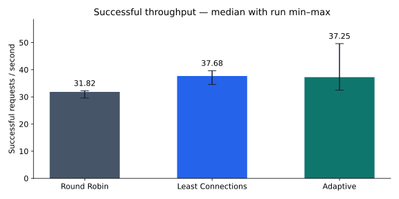
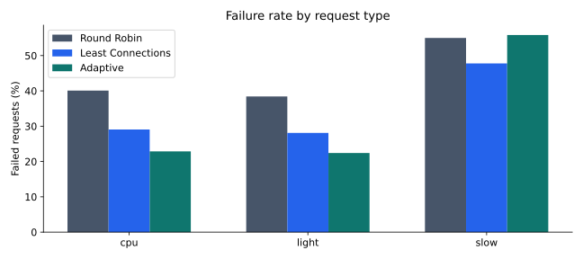

# Performance analysis — Mixed, 21/10/2026

## Phạm vi và provenance

Nguồn: `benchmarks/results/presentation-mixed-20261021`, chạy một invocation hoàn
chỉnh và pass validator: **9 run, 10.800 measured requests**. Cấu hình: ba backend
4 slot/20ms, 60% light / 10% slow / 30% CPU; 60 offered RPS, 64 client workers,
seed 20260927; 1200 đo + 300 warmup/run; ba repeats, thứ tự strategy xoay vòng.

Microsoft OpenJDK **21.0.12.1+1**, Windows 11, 16 logical CPU. Tất cả JVM chạy cùng
host với heap `-Xms32m -Xmx128m`. Baseline Git `aa7c176`, working tree dirty có
decision trace bổ sung; source/class/config hashes nằm trong snapshot. Trace tắt,
rate limiter tắt; circuit bật giống nhau cho RR/LC/Adaptive. Không đổi workload,
trọng số, timeout, capacity hoặc chọn lại run sau khi thấy kết quả.

[Bundle CSV/provenance](../benchmarks/presentation/mixed-20261021/provenance.json)
giữ phần dữ liệu cần cho chart trong Git. Full raw timings/telemetry/frozen source
vẫn ở results ignored và cần được nộp riêng nếu muốn verify độc lập toàn bộ.

## Tổng quan

Counts là tổng ba repeats/strategy. RPS và latency là **median của ba thống kê
từng run**; không phải percentile gộp. Avg/p50/p95/p99 chỉ tính HTTP 2xx, có cả client
scheduling lag. Error rate gồm mọi non-2xx và lỗi client.

| Strategy | Total | Success | Failed | Success RPS | Error % | Avg ms | p50 ms | p95 ms | p99 ms |
|---|---:|---:|---:|---:|---:|---:|---:|---:|---:|
| Round Robin | 3600 | 2139 | 1461 | 31.82 | 40.58 | 924.59 | 715.28 | 2356.61 | 2868.21 |
| Least Connections | 3600 | 2507 | 1093 | 37.68 | 30.36 | 964.21 | 890.13 | 2568.29 | 3132.02 |
| Adaptive | 3600 | 2668 | 932 | 37.25 | 25.89 | 518.31 | 58.25 | 2036.92 | 2638.75 |

Adaptive có nhiều success và ít lỗi tổng nhất trong lượt đo này. Median success
RPS lại thấp hơn LC khoảng 1,2%; không thể kết luận Adaptive thắng throughput LC.
Counts cộng ba run và median rate từng run trả lời hai câu hỏi khác nhau: mỗi run
có drain duration khác nhau, nên xếp hạng tổng success và median RPS có thể khác.

Latency successful thấp hơn không chứng minh mọi request tốt hơn: những request
đã bị reject/timeout không nằm trong tập successful latency. Report luôn đặt counts,
error rate và all-outcomes latency cạnh latency successful để tránh cách hiểu đó.

## Biến động qua repeats

| Strategy | Run 1 RPS | Run 2 RPS | Run 3 RPS | Min–max |
|---|---:|---:|---:|---:|
| RR | 29.58 | 32.26 | 31.82 | 29.58–32.26 |
| LC | 39.64 | 37.68 | 34.57 | 34.57–39.64 |
| Adaptive | 37.25 | 49.62 | 32.48 | 32.48–49.62 |

Adaptive run 2 chỉ có 101 lỗi, run 3 có 487 lỗi. Giữ cả hai; không loại run 3 là
outlier để làm đẹp median. Ba repeats chưa đủ cho kết luận có ý nghĩa thống kê.
Client lag p95 từng run LC khoảng 485–847ms; RR 113–601ms; Adaptive 15–366ms.
Load generator không hoàn toàn theo kịp lịch, nên latency chính gồm cả lag này.
Đây là giới hạn quan trọng của phép đo một host.

## Fairness theo loại request

| Strategy | Light thành công / total | CPU thành công / total | Slow thành công / total | Slow error % |
|---|---:|---:|---:|---:|
| RR | 1330 / 2160 | 647 / 1080 | 162 / 360 | 55.00 |
| LC | 1553 / 2160 | 766 / 1080 | 188 / 360 | 47.78 |
| Adaptive | 1676 / 2160 | 833 / 1080 | 159 / 360 | 55.83 |

Adaptive phục vụ light/CPU tốt hơn trong tổng ba repeats nhưng slow kém LC 29
response thành công, error rate cao hơn khoảng **8,06 điểm phần trăm**. Đây là
trade-off thực, không bị che bởi avg latency tổng giảm. Admission tối ưu tổng thể
không tự bảo đảm fairness cho công việc nặng.

Slow giữ slot 2 giây; chỉ riêng `60 × 10% × 2 = 12` slot đã bằng 3×4 slot của cả
cụm, trước light/CPU và transport overhead. ECT không tạo thêm công suất. Queue,
cold-start priors, health/circuit transitions và khả năng học service từ mẫu không
queue đều có thể tác động. **Đây là giả thuyết cần kiểm chứng**, không tách được
nguyên nhân chỉ từ bảng tổng hợp. Decision trace mới giúp quan sát từng lựa chọn
khi demo; nó không được bật hồi tố trong phép đo này.

Không thêm fairness tweak trong đợt trình bày: cần một thí nghiệm riêng chốt trước
giả thuyết, metric per-type và workload, thay vì tinh chỉnh sau khi nhìn số liệu.

## Backend distribution và cách đọc

[Biểu đồ dispatch từng backend](assets/charts/mixed-20261021/backends.svg) cộng delta
lease trong cửa sổ đo. Nó cho thấy routing không nhất thiết chia đều. Dispatch có
thể chưa tới backend nếu connect lỗi; received gồm cả rejection tại backend;
successful_client_responses là kết quả client. Proxy 503 chưa chọn backend không
được gán tùy tiện cho một server.

Không suy luận CPU bottleneck hay fairness của server chỉ từ số request. Đọc
`backends.csv`, raw telemetry và trạng thái health cùng thời gian nếu cần phân tích
sâu hơn. Các backend JVM dùng chung host nên không tương đương ba máy độc lập.

## Kết luận trong phạm vi dữ liệu

Adaptive cho thấy giá trị của dự báo công việc khi mix light/slow/CPU: ít lỗi tổng
và successful latency thấp hơn hai đối chứng trong experiment này. LC có median
success RPS cao hơn một ít và bảo vệ slow tốt hơn. Kết quả minh họa thiết kế
có trade-off, không chứng minh thuật toán tối ưu phổ quát hoặc bản mới nhanh hơn
mọi snapshot lịch sử.

Số liệu 27/09 trong [ADAPTIVE_COMPLETION](ADAPTIVE_COMPLETION.md) thuộc phiên bản/
thời điểm khác. Không ghép hai đợt thành comparison nhân quả, đặc biệt khi circuit
và lifecycle đã thay đổi. [Report offline](assets/charts/mixed-20261021/index.html)
có toàn bộ charts, bảng từng loại và run ranges để dùng khi bảo vệ.
