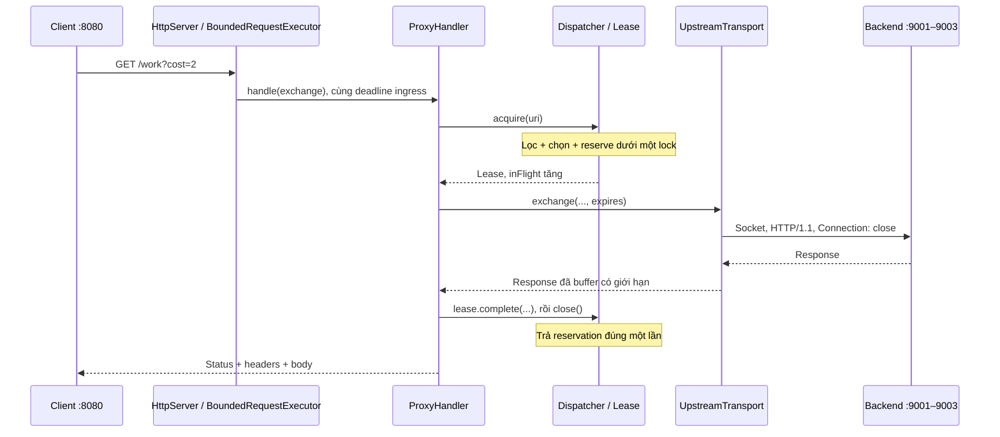

# Bắt đầu trong 5 phút

PBL4 xây dựng một reverse proxy HTTP/1.1 bằng Java 21: client dùng một địa chỉ,
proxy chuyển tiếp HTTP thật đến nhiều backend và tránh backend không sẵn sàng.
Mục tiêu nghiên cứu là so sánh RR, LC và Adaptive khi mỗi request tốn lượng công
việc khác nhau. Đây là đồ án có backend mô phỏng, chưa phải proxy production.

| Tầng | Lớp cần mở | Một câu để trình bày |
|---|---|---|
| 1. Nhận HTTP | [ReverseProxyServer](../src/main/java/com/example/proxy/server/ReverseProxyServer.java), [BoundedRequestExecutor](../src/main/java/com/example/proxy/server/BoundedRequestExecutor.java) | JDK parse HTTP và executor giới hạn số tác vụ ingress, kể cả client chưa gửi xong header. |
| 2. Điều phối request | [ProxyHandler](../src/main/java/com/example/proxy/handler/ProxyHandler.java) | Giữ request ID, permit, quota, deadline và phối hợp validation → lease → transport → response. |
| 3. Giao việc | [Dispatcher](../src/main/java/com/example/proxy/loadbalancer/Dispatcher.java) | Lọc health/circuit/capacity rồi chọn và giữ chỗ nguyên tử; lease trả công việc đúng một lần. |
| 4. Chuyển tiếp | [UpstreamTransport](../src/main/java/com/example/proxy/handler/UpstreamTransport.java) | Mở một socket/request, gửi HTTP/1.1 và đọc response vào buffer có giới hạn. |
| 5. Thực thi và quan sát | [DemoBackendServer](../src/main/java/com/example/backend/DemoBackendServer.java), [HealthChecker](../src/main/java/com/example/proxy/healthcheck/HealthChecker.java) | Backend chạy workload giả lập; health checker lấy `/health`, `/metrics` để Dispatcher dùng cho request sau. |

RR xoay vòng; LC chọn ít lease nhất. Với Adaptive, `EstimatedWork` dự báo service
EWMA và chờ slot; `AdaptiveCandidateScorer` tính ECT × penalty;
`AdaptiveLoadBalancer` chọn minimum hoặc exploration. Dispatcher sở hữu toàn bộ
lock, reservation và cập nhật trạng thái. Đây là heuristic, không phải ML.

**Ba điều cần nhớ:** lease kết thúc trước khi gửi hết body về client; `inFlight`
là reservation của proxy; CPU/heap demo đo tiến trình JVM theo budget, không phải
tài nguyên vật lý riêng của ba máy. `/products`, `/orders` là dữ liệu giả lập,
không có database thật. Lỗi 503 và request Slow bị từ chối phải được tính khi so sánh.

Đọc tiếp [một request cụ thể](REQUEST_WALKTHROUGH.md), chạy
[demo 5 phút](DEMO_5_MINUTES.md), rồi ôn [15 câu hỏi](DEFENSE_QA_SHORT.md).
Chi tiết: [kiến trúc](ARCHITECTURE.md), [Adaptive](ADAPTIVE_EXPLAINED.md),
[hướng dẫn bảo vệ](DEFENSE_GUIDE.md).
