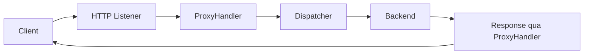

# Bản đồ code PBL4

Checkout: `reverse-proxy-demo`; artifact: `reverse-proxy`. Đường dẫn Java trong
bảng tính từ `src/main/java/com/example/`. Giữ package theo trách nhiệm đang có.

1. [proxy/Main.java](../../src/main/java/com/example/proxy/Main.java) đọc cấu hình
   qua `ConfigLoader` và tạo `ReverseProxyServer`.
2. [ReverseProxyServer](../../src/main/java/com/example/proxy/server/ReverseProxyServer.java)
   mở JDK `HttpServer`, gắn `/` vào `ProxyHandler`; `/__proxy/*` vào control plane.
3. [ProxyHandler](../../src/main/java/com/example/proxy/handler/ProxyHandler.java)
   kiểm request, giới hạn tài nguyên và xin lease backend từ `Dispatcher`.
4. [Dispatcher](../../src/main/java/com/example/proxy/loadbalancer/Dispatcher.java)
   lọc backend theo health, capability, circuit, draining và giới hạn hiện có;
   thuật toán đang chọn quyết định backend trong tập hợp lệ.
5. `UpstreamTransport` chuyển HTTP thường; `StreamingProxy` chuyển tuyến đọc file
   khi bật streaming. Backend xử lý rồi response quay qua proxy tới client.
   Các khối cleanup hiện có trả lease và tài nguyên sau khi hoàn tất hoặc lỗi.

| Cần tìm | Class / file thực tế |
|---|---|
| Cấu hình | `proxy/config/ConfigLoader.java`, `ProxyConfig.java`; `config/application.properties` |
| Kiểm tra HTTP đầu vào | `proxy/handler/IncomingRequestValidator.java`; listener policy trong `proxy/server/HttpListenerPolicy.java` |
| Ba thuật toán | `proxy/loadbalancer/RoundRobinLoadBalancer.java`, `LeastConnectionsLoadBalancer.java`, `AdaptiveLoadBalancer.java`; tạo qua `LoadBalancerFactory` |
| Tính điểm Adaptive | `proxy/loadbalancer/AdaptiveCandidateScorer.java`, `EstimatedWork.java`, `AdaptiveDecision.java` |
| Health / readiness | `proxy/healthcheck/HealthChecker.java`, `proxy/backend/BackendServer.java`; backend công bố `/health`, `/ready` và capability |
| Circuit / draining | `proxy/loadbalancer/CircuitBreaker.java`, `Dispatcher.java`, `CapabilityRouting.java`; điều khiển trong `ReverseProxyServer`, `OperatorAuth`, `OperatorCli` |
| Forward HTTP | `proxy/handler/UpstreamTransport.java`, `StreamingProxy.java` |
| Admission / concurrency | `proxy/server/BoundedRequestExecutor.java`; `proxy/handler/PriorityAdmission.java`, `ClientRateLimiter.java`, `DownloadBulkhead.java`; `proxy/util/RequestDeadline.java` |
| Host ba backend | `backend/BackendApplicationServer.java`; `RequestAdmission.java`, `BackendHttp.java`; mỗi backend một JVM |
| Workload tổng hợp | `backend/WorkloadHandler.java`, `WorkloadConsole.java`; file lớn: `LargeFileHandler.java`, `RangeRequest.java`; PDF lab: `PdfLab.java` |
| Mộc Store | `store/StoreApplication.java` → `store/controller/StoreController.java` → `store/service/*`; auth tại `store/security/*` |
| PostgreSQL | `shop/Database.java`, `ShopConfig.java`; `store/repository/*`, `store/service/OrderService.java`; SQL tại `db/migrations/` |
| Shared storage / ảnh / PDF | `store/storage/FileStorage.java`, `ProductPdf.java`, `store/service/FileService.java`; API lịch sử dùng `shop/SharedStorage.java`, `LegacyShopApi.java` |
| Metrics | `proxy/metrics/TrafficMetrics.java`, `BackendMetrics.java`, `TransportMetrics.java`; `proxy/handler/ProxyRequestMetrics.java` |
| Dashboard / giao diện | `proxy/server/MonitoringPage.java`, `backend/WorkloadConsole.java` nạp `web/monitoring.html`, `web/workload.html` qua `web/PageTemplate.java`; tài nguyên ở `src/main/resources/` |
| Giao diện cửa hàng | `src/main/resources/web/store/`; API và tài nguyên vẫn do `StoreApplication` phục vụ |

Build/test: `scripts/build.ps1`, `test.ps1`, `pom.xml` và
`src/test/java/com/example/proxy/TestSuite.java` (tự tìm mọi `*Test.java`).
Runtime: `scripts/run.ps1`, `store.py`, `app_runtime.py`, `prepare_runtime.py`.
Benchmark: `lab.py`, `research.py`, `defense_live.py`, `scripts/ops/*benchmark.py`.
Deploy: `deploy/lan/windows.ps1`, `windows_nodes.py`, `package.py` và
`deploy/compose/{Dockerfile,compose.yaml}`. Xem [bản đồ script](../deployment/OPERATIONS_UPGRADE.md).

`DemoBackendServer`, `shop_demo.py`, `shop_prepare.py` là adapter tương thích;
giữ để runner cũ còn tìm được entrypoint. RR/LC/Adaptive, API, SQL, timeout,
admission, lease và các mặc định runtime không đổi trong đợt dọn này.
