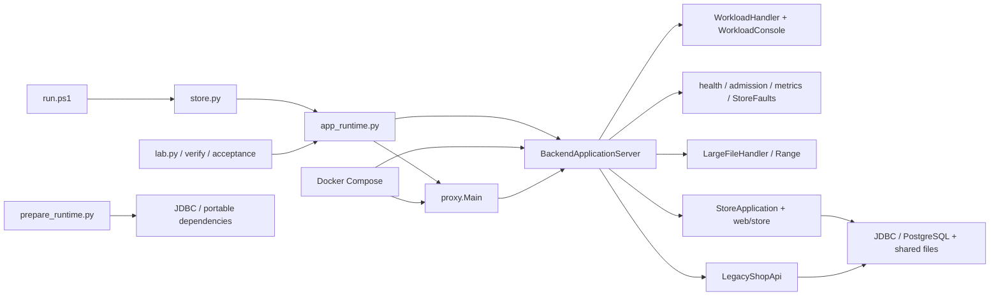

# Tái cấu trúc và dọn workspace PBL4 — 15/11/2026

Repository vật lý duy nhất: `D:\PBL4\reverse-proxy-demo`; remote
`nguyenvanquanghjhj/reverse-proxy`. Giữ tên checkout vì IDE, cấu hình và dữ liệu
local đang dùng đường dẫn này. Artifact sản phẩm là `reverse-proxy`.

Mốc main `8a2cc59c514cfde633637f1755c9c299161b2e31`; branch làm việc
`refactor/repository-cleanup-20261115` kế thừa audit đã kiểm thử ở `f3b56cc`.
Các commit nhỏ: `00a531f` tách backend/workload; `c67efbb` hợp nhất storefront và
runtime. Không thay công thức RR/LC/Adaptive, giao dịch, schema/migration hoặc dữ
liệu người dùng. SHA cuối, CI và Git status được chốt trong
[FINAL.md](D:/PBL4/evidence/restructure-20261115/FINAL.md), sau khi push/merge và CI
thực sự hoàn thành. Không coi CI đang chạy là PASS.

## Kiến trúc trước và sau

Trước: `DemoBackendServer` ghép host/dispatch/workload/render; `DemoPage` là console
nghiên cứu đang dùng. `ShopHandler` tải giao diện shop cũ đồng thời hệ Store phục
vụ UI khác. `store.py` và các runner nhập lifecycle từ `shop_demo.py`; tên Maven
và README vẫn thiên về demo. Source/backend/store/ops đã có package riêng: giữ
ranh giới đó, không đổi hàng loạt `com.example`.



| Thay đổi thật | Dependency / tương thích / lý do |
|---|---|
| `DemoBackendServer` → `BackendApplicationServer` | Host canonical giữ listener, health, worker/admission, dispatch. Lớp cũ còn adapter constructor/start/close/main cho runner đã lưu. |
| Tách `WorkloadHandler`, `BackendHttp` | Synthetic CPU/echo/download và render không còn nằm trong host; query/framing helper dùng chung, không sao chép hai implementation. |
| `DemoPage` → `WorkloadConsole` | `/workload` là canonical; `/demo` giữ HTTP 200 cùng handler. MonitoringPage, scripts, Compose và test được cập nhật. |
| `ShopHandler` → `LegacyShopApi` | Giữ API product/order/document và transaction lịch sử; lớp ShopHandler chỉ delegate. Không xóa bảng/migration. |
| Xóa `ShopPage.java` và năm asset `web/shop/{api.js,index.html,order-state.js,shop.css,shop.js}` | Không phục vụ Mộc Store; bỏ UI thứ hai và eager resource load. Khi STORE_ENABLED=true, `/shop` thuộc Store; legacy-only trả 410 LEGACY_UI_RETIRED kèm hướng dẫn bật Store, đã kiểm bằng HTTP thật. |
| Giữ `web/store/cart.js`, `checkout.js`, admin CSS | Dependency thực: site → checkout → cart, và admin dùng CSS riêng. Không xóa theo tên. |
| `shop_demo.py` → `app_runtime.py` | Một lifecycle implementation; module cũ alias cùng identity/state, không tạo tracking khác nhau. store/lab dùng canonical. |
| `shop_prepare.py` → `prepare_runtime.py` | Một implementation chuẩn bị pinned dependency; không khởi tạo DB. Adapter cũ giữ import/CLI. |
| `run.ps1 -EnvFile` | Launcher thật có thể quản lý JVM của DB được chọn, không init/stop cluster mặc định. PBL4_RUNTIME_DIR tuyệt đối dùng QA riêng; mặc định `.shop` không đổi. |
| Maven/native JAR `reverse-proxy` | Native build vẫn cách ly target/standalone khỏi classes của IDE/Maven; Docker dùng classes/lib, không phụ thuộc tên JAR cũ. |
| `qa_paths.py` | Output live QA mặc định ở evidence cạnh checkout, tên run duy nhất; chặn output trong checkout trước payload/DB work; yêu cầu private env rõ ràng. |
| Retention streaming | PASS + JVM đóng: kiểm size/SHA rồi xóa đúng 5 input mới tạo (489 MiB); recipe/hash/receipt giữ lại. FAIL và --retain-fixtures giữ input. Không quét/xóa DB, store files hoặc raw evidence. |
| Tài liệu lịch sử | original_ci → docs/history/original_ci; installer patch/manifest → history/unified; core manifest → history/core; README cũ → history. Patch giữ byte/SHA và rule .gitattributes riêng. |
| CI / ignore / README | Thêm branch refactor vào trigger 4 jobs; ignore private QA env/runtime lồng nhau; README mới chỉ rõ sản phẩm, workload, streaming đã tích hợp nhưng mặc định OFF. |

Full dependency map (Java imports/main, Python AST imports, web references, route
literals, launchers) và classification từng source file:
[dependency-inventory.json](D:/PBL4/evidence/restructure-20261115/dependency-inventory.json).
Không còn local Java import hoặc static web asset không resolve. Dynamic browser
URLs được kiểm bằng browser/SQL acceptance, không coi là file path.

| Source/module count | Trước f3b56cc | Sau |
|---|---|---|
| Tracked source/config/docs files | 248 | 253 |
| Java source files | 104 | 107 |
| Java test mains | 30 | 30 |
| Python scripts | 33 | 37 |

File count tăng do tách trách nhiệm và adapter tương thích; không tạo bản checkout sản phẩm khác. Role của từng file nằm trong dependency inventory; generated/private data không thuộc tracked source count.

## Cây thư mục

```text
Trước D:\PBL4                    Sau D:\PBL4 (physical directories)
reverse-proxy-demo/              reverse-proxy-demo/       checkout duy nhất
core-upgrade-acceptance-.../      evidence/core-20261115/
storage-maintenance-.../         evidence/maintenance-20261115/
final-acceptance-.../             evidence/final-20261107/
unified-acceptance-.../           unified-acceptance-.../   giữ ngoại lệ ACL
  tools/                        tools/                    toolchain dùng chung
v6-evidence/                     archives/research-v6/
reference-repos/                 archives/reference-repos/ giữ source lịch sử
pdf_review/                      reports/pdf-review/
hai evidence ZIP ở root          archives/releases/
                                evidence/restructure-20261115/ QA đợt này
```

Tên cũ của các directory đã chuyển là junction tương thích, không phải bản sao.
tools cũ cũng là junction; parent aliases trong evidence/archives giữ runner đã
lưu dùng `Path(__file__).resolve().parent`. Inventory liệt kê links và không đi
xuyên để tránh tính trùng. New work dùng canonical paths. Các helper install/
merge/cleanup một lần trong lịch sử được lưu làm bằng chứng, không phải lệnh chạy
hiện tại. Không di chuyển runtime/DB đang chạy. PostgreSQL trong các parent đã
chuyển đều đã dừng; hash toàn bộ tệp đọc được được đối chiếu sau di chuyển.
Unified parent giữ nguyên do một subtree không đọc được. Mỗi move cùng ổ có
`claimed_bytes_freed=0` trong [moves.json](D:/PBL4/evidence/restructure-20261115/moves.json).

```text
Repository trước                  Repository sau
src/main/java/com/example/        src/main/java/com/example/
  proxy/                           proxy/                    core giữ ranh giới
  backend/DemoBackendServer        backend/BackendApplicationServer + WorkloadHandler
          DemoPage                         WorkloadConsole + BackendHttp
  shop/ShopHandler + ShopPage       shop/LegacyShopApi + ShopHandler adapter
  store/                           store/                    giữ nghiệp vụ
resources/web/shop + web/store    resources/web/store       một UI
scripts/shop_demo.py              scripts/app_runtime.py + shop_demo adapter
scripts/shop_prepare.py           scripts/prepare_runtime.py + adapter
scripts/{store,lab,research,...}   scripts/{store,lab,research,...} + qa_paths.py
scripts/ops/                      scripts/ops/               backup/QA/operations
docs/original_ci + old patches    docs/history/              archive có index
docs/maintenance/                 docs/maintenance/          report/audit
src/test/java/                    src/test/java/             đủ 30 mains
```

## Dung lượng và dữ liệu bảo toàn

Đo trực tiếp Windows bằng file allocation NTFS; số logical là nội dung, allocated
là phần cấp phát. Không tính junction hai lần; hardlink đếm physical một lần;
không gộp các thư mục cha/con trong bảng top. Không tính di chuyển hoặc Recycle
Bin là tiết kiệm. Không xóa bằng reset/clean/prune; không sửa ACL để ép truy cập.
Directory/NTFS metadata và storage Docker ngoài workspace không thuộc số file
allocation. Các snapshot trước/sau đều có cùng một khoảng chưa đọc được, vì vậy
tổng toàn workspace là phần đọc được, không tuyên bố đã kiểm đầy đủ vùng ACL.

| Phạm vi | Logical bytes | Unique allocated bytes |
|---|---|---|
| Trước, readable D:/PBL4 | 6171255947 | 3288135400 |
| Sau, cùng phạm vi (không gồm run mới) | 5633234727 | 2749854608 |
| Toàn bộ run QA/audit mới, cộng riêng | 322808308 | 266604568 |
| Sau gồm cả run mới | 5956043035 | 3016459176 |

Thu hồi ròng ở snapshot này: **271,676,224 allocated bytes (0.272 GB decimal)**, đã trừ dung lượng toàn bộ QA/audit mới. Metadata/CI receipts phát sinh sau snapshot được chốt lại trong FINAL.md. Không cộng phần tiết kiệm của đợt audit trước vào đợt này.

| Vùng (các dòng có thể lồng nhau) | Trước logical | Trước allocated | Sau logical | Sau allocated |
|---|---|---|---|---|
| reverse-proxy-demo → reverse-proxy-demo | 384553757 | 381727232 | 383823083 | 380743336 |
| reverse-proxy-demo/.git → reverse-proxy-demo/.git | 24102836 | 24218128 | 24136470 | 24200632 |
| reverse-proxy-demo/target → reverse-proxy-demo/target | 25907014 | 20170512 | 25081334 | 19129904 |
| reverse-proxy-demo/.shop → reverse-proxy-demo/.shop | 223323826 | 223372960 | 223323826 | 223372960 |
| reverse-proxy-demo/.runtime → reverse-proxy-demo/.runtime | 100349891 | 102335472 | 100349891 | 102335472 |
| reverse-proxy-demo/shared-files → reverse-proxy-demo/shared-files | 4068688 | 4308992 | 4068688 | 4308992 |
| unified-acceptance-20261115 → unified-acceptance-20261115 | 1355369041 | 1190608232 | 289022434 | 233427960 |
| unified-acceptance-20261115/tools → tools | 1066346607 | 957180272 | 529054453 | 419879280 |
| core-upgrade-acceptance-20261115 → evidence/core-20261115 | 2916061150 | 805505656 | 2916061150 | 805505656 |
| storage-maintenance-20261115 → evidence/maintenance-20261115 | 754387311 | 308803472 | 754387311 | 308803472 |
| final-acceptance-20261107 → evidence/final-20261107 | 195213662 | 138412760 | 195213662 | 138412760 |
| v6-evidence → archives/research-v6 | 435439790 | 331878520 | 435439790 | 331878520 |
| reference-repos → archives/reference-repos | 3729241 | 4686376 | 3729241 | 4686376 |
| pdf_review → reports/pdf-review | 416430 | 421888 | 416430 | 421888 |

Ba file bị xóa là **cache tải bên thứ ba**, không phải bundle PBL4/provenance:

| Cache tải đã xóa | Logical bytes |
|---|---|
| microsoft-jdk-21.0.13.0.2-windows-x64.zip | 201450315 |
| apache-maven-3.10.0-bin.zip | 10102082 |
| postgresql-16.14-1-windows-x64-binaries.zip | 325739757 |

Cache tải: 537,292,154 logical / **537,300,992 allocated bytes** thu hồi thực. Không xóa bản cài đã xác minh. Hai run streaming của đợt này giải phóng tổng 1,025,507,328 logical bytes input vừa tạo; đây là tránh tăng dung lượng QA mới, không cộng thêm vào cache saving trước/sau.

Trước xóa đã kiểm hash bản tải pin, toàn ZIP CRC, đối chiếu 2.234 file JDK/Maven/PG
được cài với nội dung ZIP; executable/toolchain vẫn dùng được sau chuyển. Recipe,
URL/hash và toàn danh sách đối chiếu giữ trong
[tool-cache-deletion-plan.json](D:/PBL4/evidence/restructure-20261115/tool-cache-deletion-plan.json).
JDK lib/src.zip là thành phần đã cài, không nhầm là cache tải. Không xóa Downloads
PBL4 bundles; tổng chỉ vài trăm KB, còn provenance/reference. Không giải nén ba ZIP
provenance. Các fixture lịch sử lớn giữ nguyên để tái kiểm nghiệm; chỉ input vừa
tạo trong QA của đợt này được giải phóng theo receipt sau PASS.

5323 tệp `.shop`, `.runtime`, `shared-files`, `.env.store`, `db` giữ SHA; assembler
user sửa giữ byte; 23.233 tệp ngoài checkout ban đầu giữ SHA qua di chuyển (ngoại
trừ 3 cache tải đã nêu). Bằng chứng:
[preservation-result.json](D:/PBL4/evidence/restructure-20261115/preservation-result.json),
[moves-sha-verification.json](D:/PBL4/evidence/restructure-20261115/moves-sha-verification.json).
Raw PASS/FAIL/CSV/JSON, databases cũ/mới, backup archive, ảnh/PDF được giữ. Không
đưa private env/database/archive/log lớn vào Git. PostgreSQL QA đợt này là cluster
mới 127.0.0.1:55458; source real DB và các cluster cũ không được khởi chạy/thay đổi.

**UNKNOWN giữ nguyên:** `unified-acceptance-20261115/backup-restore/restored-files`
trả WinError 5 cả khi thử quyền cao hơn; inventory báo incomplete. Manifest cũ liệt
kê 34 tệp / 4.127.530 byte logical nhưng lần này không xác nhận SHA/allocation hoặc
có thêm tệp. Không xóa/chuyển/sửa ACL subtree hoặc parent này. Không có thao tác
người dùng bắt buộc để chạy sản phẩm; đây là giới hạn của audit dữ liệu lịch sử.

Docker Engine local không có named pipe/CLI, nên disk usage/cache/images/volumes
local là NOT RUN; không suy ra bằng số đĩa của CI. Compose CLI config chạy thật.

### 30 vùng lớn nhất trước dọn

Thư mục cha/con lồng nhau; không cộng tổng các dòng. Đây là nguyên nhân dữ liệu lớn, không phải danh sách được phép xóa.

| # | Absolute path | Logical bytes | Allocated bytes |
|---|---|---|---|
| 1 | D:\PBL4\core-upgrade-acceptance-20261115 | 2916061150 | 805505656 |
| 2 | D:\PBL4\unified-acceptance-20261115 | 1355369041 | 1190608232 |
| 3 | D:\PBL4\unified-acceptance-20261115\tools | 1066346607 | 957180272 |
| 4 | D:\PBL4\storage-maintenance-20261115 | 754387311 | 308803472 |
| 5 | D:\PBL4\core-upgrade-acceptance-20261115\streaming-01 | 525710631 | 102164648 |
| 6 | D:\PBL4\core-upgrade-acceptance-20261115\streaming-final-03 | 517420570 | 100625280 |
| 7 | D:\PBL4\storage-maintenance-20261115\streaming | 517418492 | 100404096 |
| 8 | D:\PBL4\core-upgrade-acceptance-20261115\streaming-final-02 | 517414331 | 100625240 |
| 9 | D:\PBL4\core-upgrade-acceptance-20261115\streaming-final | 517387454 | 100604760 |
| 10 | D:\PBL4\core-upgrade-acceptance-20261115\streaming-02 | 517381919 | 100600664 |
| 11 | D:\PBL4\v6-evidence | 435439790 | 331878520 |
| 12 | D:\PBL4\core-upgrade-acceptance-20261115\streaming-01\public-downloads | 415234904 | 77856768 |
| 13 | D:\PBL4\core-upgrade-acceptance-20261115\streaming-final-03\public-downloads | 407896103 | 76349480 |
| 14 | D:\PBL4\storage-maintenance-20261115\streaming\public-downloads | 407896103 | 76349480 |
| 15 | D:\PBL4\core-upgrade-acceptance-20261115\streaming-02\public-downloads | 407896064 | 76349440 |
| 16 | D:\PBL4\core-upgrade-acceptance-20261115\streaming-final\public-downloads | 407896064 | 76349440 |
| 17 | D:\PBL4\core-upgrade-acceptance-20261115\streaming-final-02\public-downloads | 407896064 | 76349440 |
| 18 | D:\PBL4\reverse-proxy-demo | 384553757 | 381727232 |
| 19 | D:\PBL4\unified-acceptance-20261115\tools\jdk21\jdk-21.0.13.0.2+1 | 343464884 | 276786808 |
| 20 | D:\PBL4\unified-acceptance-20261115\tools\jdk21 | 343464884 | 276786808 |
| 21 | D:\PBL4\reverse-proxy-demo\.shop | 223323826 | 223372960 |
| 22 | D:\PBL4\unified-acceptance-20261115\tools\jdk21\jdk-21.0.13.0.2+1\lib | 207000414 | 148226080 |
| 23 | D:\PBL4\final-acceptance-20261107 | 195213662 | 138412760 |
| 24 | D:\PBL4\core-upgrade-acceptance-20261115\postgres-data | 159267024 | 159301216 |
| 25 | D:\PBL4\storage-maintenance-20261115\postgres-data | 132498667 | 132523512 |
| 26 | D:\PBL4\unified-acceptance-20261115\tools\pg16\pgsql | 126315345 | 98513904 |
| 27 | D:\PBL4\unified-acceptance-20261115\tools\pg16 | 126315345 | 98513904 |
| 28 | D:\PBL4\core-upgrade-acceptance-20261115\postgres-data\base | 124637987 | 124656440 |
| 29 | D:\PBL4\reverse-proxy-demo\.shop\store-postgres | 122613422 | 122628544 |
| 30 | D:\PBL4\unified-acceptance-20261115\postgres-data | 101850425 | 101872072 |

### 50 file lớn nhất trước dọn

| # | Absolute path | Logical bytes | Allocated bytes |
|---|---|---|---|
| 1 | D:\PBL4\unified-acceptance-20261115\tools\postgresql-16.14-1-windows-x64-binaries.zip | 325739757 | 325742592 |
| 2 | D:\PBL4\core-upgrade-acceptance-20261115\streaming-01\public-downloads\file-256.bin | 268435456 | 50331648 |
| 3 | D:\PBL4\core-upgrade-acceptance-20261115\streaming-02\public-downloads\file-256.bin | 268435456 | 50331648 |
| 4 | D:\PBL4\core-upgrade-acceptance-20261115\streaming-final\public-downloads\file-256.bin | 268435456 | 50331648 |
| 5 | D:\PBL4\core-upgrade-acceptance-20261115\streaming-final-02\public-downloads\file-256.bin | 268435456 | 50331648 |
| 6 | D:\PBL4\core-upgrade-acceptance-20261115\streaming-final-03\public-downloads\file-256.bin | 268435456 | 50331648 |
| 7 | D:\PBL4\storage-maintenance-20261115\streaming\public-downloads\file-256.bin | 268435456 | 50331648 |
| 8 | D:\PBL4\unified-acceptance-20261115\tools\microsoft-jdk-21.0.13.0.2-windows-x64.zip | 201450315 | 201453568 |
| 9 | D:\PBL4\unified-acceptance-20261115\tools\jdk21\jdk-21.0.13.0.2+1\lib\modules | 141207998 | 82399232 |
| 10 | D:\PBL4\core-upgrade-acceptance-20261115\streaming-01\public-downloads\file-100.bin | 104857600 | 19660800 |
| 11 | D:\PBL4\core-upgrade-acceptance-20261115\streaming-01\resumed-100.bin | 104857600 | 19660800 |
| 12 | D:\PBL4\core-upgrade-acceptance-20261115\streaming-02\public-downloads\file-100.bin | 104857600 | 19660800 |
| 13 | D:\PBL4\core-upgrade-acceptance-20261115\streaming-02\resumed-100.bin | 104857600 | 19660800 |
| 14 | D:\PBL4\core-upgrade-acceptance-20261115\streaming-final\public-downloads\file-100.bin | 104857600 | 19660800 |
| 15 | D:\PBL4\core-upgrade-acceptance-20261115\streaming-final\resumed-100.bin | 104857600 | 19660800 |
| 16 | D:\PBL4\core-upgrade-acceptance-20261115\streaming-final-02\public-downloads\file-100.bin | 104857600 | 19660800 |
| 17 | D:\PBL4\core-upgrade-acceptance-20261115\streaming-final-02\resumed-100.bin | 104857600 | 19660800 |
| 18 | D:\PBL4\core-upgrade-acceptance-20261115\streaming-final-03\public-downloads\file-100.bin | 104857600 | 19660800 |
| 19 | D:\PBL4\core-upgrade-acceptance-20261115\streaming-final-03\resumed-100.bin | 104857600 | 19660800 |
| 20 | D:\PBL4\storage-maintenance-20261115\streaming\public-downloads\file-100.bin | 104857600 | 19660800 |
| 21 | D:\PBL4\storage-maintenance-20261115\streaming\resumed-100.bin | 104857600 | 19660800 |
| 22 | D:\PBL4\PBL4-final-acceptance-20261107.zip | 90712203 | 90714112 |
| 23 | D:\PBL4\unified-acceptance-20261115\tools\jdk21\jdk-21.0.13.0.2+1\lib\src.zip | 53082420 | 53084160 |
| 24 | D:\PBL4\final-acceptance-20261107\research\proxy.log | 43428878 | 13549568 |
| 25 | D:\PBL4\v6-evidence\v7-research\proxy.log | 41692304 | 13000704 |
| 26 | D:\PBL4\PBL4-v7-evidence.zip | 35373362 | 35377152 |
| 27 | D:\PBL4\unified-acceptance-20261115\tools\docker-compose-windows-x86_64.exe | 34616320 | 19505152 |
| 28 | D:\PBL4\core-upgrade-acceptance-20261115\streaming-01\public-downloads\file-32.bin | 33554432 | 6291456 |
| 29 | D:\PBL4\core-upgrade-acceptance-20261115\streaming-02\public-downloads\file-32.bin | 33554432 | 6291456 |
| 30 | D:\PBL4\core-upgrade-acceptance-20261115\streaming-final\public-downloads\file-32.bin | 33554432 | 6291456 |
| 31 | D:\PBL4\core-upgrade-acceptance-20261115\streaming-final-02\public-downloads\file-32.bin | 33554432 | 6291456 |
| 32 | D:\PBL4\core-upgrade-acceptance-20261115\streaming-final-03\public-downloads\file-32.bin | 33554432 | 6291456 |
| 33 | D:\PBL4\storage-maintenance-20261115\streaming\public-downloads\file-32.bin | 33554432 | 6291456 |
| 34 | D:\PBL4\reverse-proxy-demo\.shop\proxy.log | 32559965 | 32563200 |
| 35 | D:\PBL4\reverse-proxy-demo\.runtime\postgres\bin\icudt67.dll | 28399104 | 28401664 |
| 36 | D:\PBL4\unified-acceptance-20261115\tools\pg16\pgsql\bin\icudt67.dll | 28399104 | 17682432 |
| 37 | D:\PBL4\reverse-proxy-demo\.git\objects\pack\pack-e70b0798561b0a9e5b4e5f019c6764471b2e2e9c.pack | 23529660 | 23531520 |
| 38 | D:\PBL4\unified-acceptance-20261115\tools\jdk21\jdk-21.0.13.0.2+1\jmods\java.base.jmod | 22237621 | 22241280 |
| 39 | D:\PBL4\final-acceptance-20261107\git-diff.patch | 19072098 | 19075072 |
| 40 | D:\PBL4\v6-evidence\v7-failures\proxy.log | 18037818 | 5619712 |
| 41 | D:\PBL4\core-upgrade-acceptance-20261115\postgres-data\pg_wal\000000010000000000000005 | 16777216 | 16777216 |
| 42 | D:\PBL4\core-upgrade-acceptance-20261115\postgres-data\pg_wal\000000010000000000000006 | 16777216 | 16777216 |
| 43 | D:\PBL4\reverse-proxy-demo\.shop\legacy-postgres\pg_wal\000000010000000000000002 | 16777216 | 16777216 |
| 44 | D:\PBL4\reverse-proxy-demo\.shop\legacy-postgres\pg_wal\000000010000000000000003 | 16777216 | 16777216 |
| 45 | D:\PBL4\reverse-proxy-demo\.shop\store-postgres\pg_wal\00000001000000000000000A | 16777216 | 16777216 |
| 46 | D:\PBL4\reverse-proxy-demo\.shop\store-postgres\pg_wal\00000001000000000000000B | 16777216 | 16777216 |
| 47 | D:\PBL4\storage-maintenance-20261115\postgres-data\pg_wal\000000010000000000000003 | 16777216 | 16777216 |
| 48 | D:\PBL4\storage-maintenance-20261115\postgres-data\pg_wal\000000010000000000000004 | 16777216 | 16777216 |
| 49 | D:\PBL4\storage-maintenance-20261115\postgres-data\pg_wal\000000010000000000000005 | 16777216 | 16777216 |
| 50 | D:\PBL4\unified-acceptance-20261115\postgres-data\pg_wal\000000010000000000000003 | 16777216 | 16777216 |

## Kiểm thử thật và giới hạn phép đo

| Hạng mục | Trạng thái | Phạm vi | Log/bằng chứng |
|---|---|---|---|
| Java 21 native / Maven -Pshop | PASS | 30 / 30 mains | [16-native-final.log](D:/PBL4/evidence/restructure-20261115/16-native-final.log), [06-maven.log](D:/PBL4/evidence/restructure-20261115/06-maven.log) |
| Python / preserved HTTP tooling | PASS | 29 tests / HTTP harness | [15-python-retention.log](D:/PBL4/evidence/restructure-20261115/15-python-retention.log), [22-http-tooling.log](D:/PBL4/evidence/restructure-20261115/22-http-tooling.log) |
| JDBC / transaction / capability / QoS / auth | PASS | 30 checks | [07-operational.log](D:/PBL4/evidence/restructure-20261115/07-operational.log) / [operational/result.json](D:/PBL4/evidence/restructure-20261115/operational/result.json) |
| Mộc Store browser / SQL / response loss | PASS | 316 checks | [08-browser.log](D:/PBL4/evidence/restructure-20261115/08-browser.log) / [browser-01/acceptance.json](D:/PBL4/evidence/restructure-20261115/browser-01/acceptance.json) |
| Streaming 32/100/256 MiB / SHA / Range / faults / memory | PASS | 70 checks | [21-streaming-retention.log](D:/PBL4/evidence/restructure-20261115/21-streaming-retention.log) / [streaming-retention/result.json](D:/PBL4/evidence/restructure-20261115/streaming-retention/result.json) |
| Health / circuit / drain / watchdog | PASS | 20 checks | [10-operations.log](D:/PBL4/evidence/restructure-20261115/10-operations.log) / [operations-live/result.json](D:/PBL4/evidence/restructure-20261115/operations-live/result.json) |
| Backup/restore mới / DB & files hashes | PASS | 15 checks | [12-backup-restore.log](D:/PBL4/evidence/restructure-20261115/12-backup-restore.log) / [backup-restore/result.json](D:/PBL4/evidence/restructure-20261115/backup-restore/result.json) |
| PowerShell/Python start/stop/restart / legacy API | PASS | 27 checks | [20-entrypoints-new-db.log](D:/PBL4/evidence/restructure-20261115/20-entrypoints-new-db.log) / [entrypoints-03/result.json](D:/PBL4/evidence/restructure-20261115/entrypoints-03/result.json) |
| Compose config | PASS | CLI thực, không deploy | [13-compose.log](D:/PBL4/evidence/restructure-20261115/13-compose.log) |
| Bảo toàn dữ liệu / historical moves | PASS | 5323 + 23233 files SHA | preservation-result.json / moves-sha-verification.json trong evidence root |
| RR/LC/Adaptive thực nghiệm | PASS | 18 runs, giữ cả HTTP errors | [11-algorithms.log](D:/PBL4/evidence/restructure-20261115/11-algorithms.log); bảng dưới |
| Linux/Windows CI + Docker restart (source branch) | PASS | 4/4 jobs; 68 Docker checks; main cuối xem FINAL.md | https://github.com/nguyenvanquanghjhj/reverse-proxy/actions/runs/43693122171 |
| Docker Engine/disk/cache local | NOT RUN | Không có Engine; không prune volumes | [environment-limits-final.log](D:/PBL4/evidence/restructure-20261115/environment-limits-final.log) |
| LAN nhiều máy | NOT RUN | Không có host thứ hai | Loopback và Docker bridge không được gọi là LAN |
| SHA/allocation subtree restore cũ bị ACL | NOT RUN | Giữ nguyên; không có quyền enumerate | before.json / after.json errors |

Lỗi ban đầu `14-entrypoints.log`: còn directory web/shop rỗng trên Windows nên
JAR chứa entry directory legacy. Đã xóa đúng directory rỗng, build/test lại đủ 30
mains và kiểm archive/launcher lại; không bỏ assertion. Các log FAIL được giữ.

`17-entrypoints-final.log` dùng lại DB fixture nhưng đổi files root, nên metadata
trỏ file thiếu và startup bị timeout; đã tạo cặp DB/root mới, không reset DB cũ,
và `20-entrypoints-new-db.log` PASS 27 checks. `24-final-preservation-inventory.log`
bị Git repack đồng thời làm biến mất loose object lúc stat; inventory quiescent
`25-inventory-quiescent.log` chạy lại hoàn chỉnh trong phạm vi đọc được. Probe
PowerShell đầu thiếu ExecutionPolicy trong process; lần probe cuối chạy đúng.
Các lỗi harness/probe này và mọi exit code giữ trong runs.jsonl, không bị xóa.

Mỗi profile/strategy: 3 repeat × 180 request, concurrency 12, cùng seed và request mix; shuffle thứ tự cố định. Homogeneous capacities 4/4/4, delay 15/15/15 ms, CPU budget 2/2/2; heterogeneous 8/4/2, delay 0/60/180 ms, budget 4/2/1. Active strategy xác nhận qua metrics trước/sau, CPU/RSS/socket samples thật; inFlight về 0.

| Profile | Strategy | 200 thành công | Tổng | HTTP fail | Transport fail | p95 mọi outcome 3 repeats (ms) |
|---|---|---|---|---|---|---|
| homogeneous | ROUND_ROBIN | 538 | 540 | 2 | 0 | 2008.3128, 2013.3994, 2017.6704 |
| homogeneous | LEAST_CONNECTIONS | 540 | 540 | 0 | 0 | 2006.4213, 2014.1796, 2017.2032 |
| homogeneous | ADAPTIVE | 540 | 540 | 0 | 0 | 2008.7982, 2016.5435, 2018.5395 |
| heterogeneous | ROUND_ROBIN | 534 | 540 | 6 | 0 | 2075.7326, 2228.0988, 2293.4647 |
| heterogeneous | LEAST_CONNECTIONS | 538 | 540 | 2 | 0 | 2007.714, 2014.1486, 2021.9143 |
| heterogeneous | ADAPTIVE | 530 | 540 | 10 | 0 | 2008.5129, 2020.3425, 2028.7144 |

Raw status counts: `{'200': 3220, '504': 20}`. Không có tiêu chí mọi request phải 200 ở workload áp lực này: deadline/admission là behavior được đo. **Không gọi các HTTP 504 là thành công.** Đợt baseline trước có 12 HTTP failures; đợt này 20; background Windows/IDE không được kiểm soát, đây không phải phép chứng minh cải thiện hay tương đương hiệu năng. Không thay scheduler/timeout để giảm error. Bảng p95 gồm mọi outcome; raw CSV và samples giữ tại [benchmark-01](D:/PBL4/evidence/restructure-20261115/benchmark-01/result.json). LAN chưa đo.


Upstream pool mặc định false; QoS reservation 0; streaming mặc định false.
Các chế độ ON được kiểm trong fixture/PostgreSQL riêng, có đặt hàng và replay,
không sửa `.env.store`. Không tăng timeout hoặc sửa thuật toán để đổi kết quả đo.

## Chạy trên Windows hiện tại và máy mới

Máy hiện tại: mở terminal ở checkout, chọn toolchain trong process (không đổi JDK
hệ thống/IDE):

```powershell
$env:JAVA_HOME = 'D:\PBL4\tools\jdk21\jdk-21.0.13.0.2+1'
$env:PATH = "$env:JAVA_HOME\bin;D:\PBL4\tools\maven\apache-maven-3.10.0\bin;$env:PATH"
java --version
powershell -NoProfile -ExecutionPolicy Bypass -File scripts/run.ps1 start
powershell -NoProfile -ExecutionPolicy Bypass -File scripts/run.ps1 status
python scripts/store.py stop
```

Trang chính http://127.0.0.1:8080/shop; admin /admin; dashboard
/__proxy/dashboard; workload /workload. `run.ps1 stop` mặc định dừng DB local do
launcher quản lý, giữ data; `store.py stop` chỉ dừng JVM. Nếu chọn explicit EnvFile,
run.ps1 không init/stop cluster mặc định. Không chạy historical helper.

Máy Windows mới: cài Git, Python 3.12, JDK 21 và đưa bin lên PATH; clone một lần,
cd vào checkout; kiểm java --version; chạy run.ps1 start như README. Lần đầu cần
mạng để lấy pinned JDBC/PG, tạo DB mới ở 55434, seed và sinh admin credentials
trong `.shop/admin-access.txt`. Không copy `.env.store`/secrets cũ vào clone mới.
Với DB có sẵn, dùng explicit private env và migrate/seed có chủ đích theo README;
không chạy setup/seed trên dữ liệu thật khi chỉ cần restart.

Regression: scripts/test.ps1; Maven -Pshop test; unittest discover scripts/ops;
test_defense_live.py. Live QA dùng private env của DB riêng, output evidence ngoài
checkout. Full command/cwd/UTC/exit/duration và mọi log:
[runs.jsonl](D:/PBL4/evidence/restructure-20261115/runs.jsonl).
Full per-file absolute path/mtime/Git/classification/SHA, related Downloads và
duplicates: [inventory index](D:/PBL4/evidence/restructure-20261115/inventory-index.json).
Không quét tài liệu khác ngoài vùng PBL4 được xác định.

## Git và release

Chỉ push khi toàn bộ regression local bắt buộc PASS. Branch CI phải PASS 4/4 trước normal merge; main cuối cũng phải PASS 4/4. Không force-push/reset/rewrite history. Receipt local cuối và CI commit chính xác được ghi trong FINAL.md và acceptance-results.json ngoài Git để không phải ghi SHA tự tham chiếu vào commit. Phần UNKNOWN cũ không bị thay đổi và không được xóa.

Branch CI đã xác nhận: [43693122171](https://github.com/nguyenvanquanghjhj/reverse-proxy/actions/runs/43693122171), SHA `6a21038d3c2cccc0ec4c28790fddb3a4136b9676`, conclusion `success`. Final main CI có receipt riêng trong FINAL.md.
