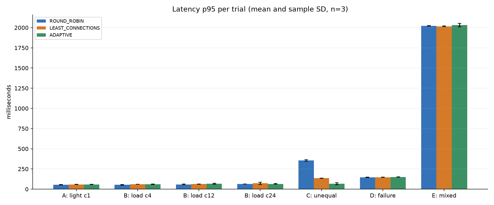
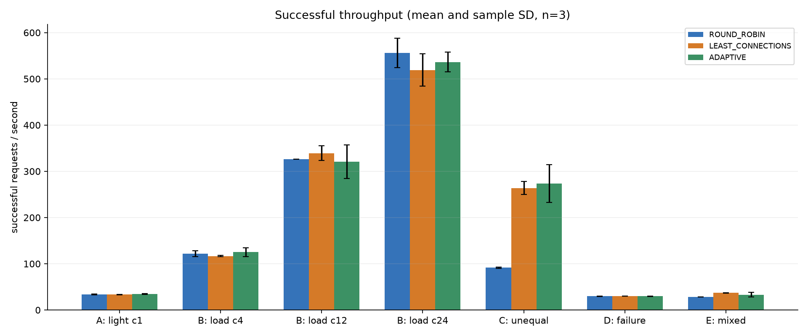
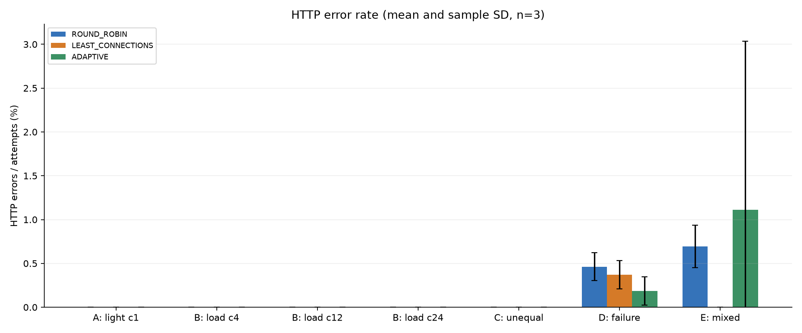

# PBL4 — NGHIỆM THU SAU SỬA LỖI VÀ BENCHMARK

**Trạng thái hiện hành:** xem [mục 13 — chốt main, CI và vệ sinh repository](#13-chốt-main-ci-và-vệ-sinh-repository).
Các mục 1–12 bên dưới giữ bối cảnh snapshot đo trước commit; việc đưa vào main
và CI sau đó không có nghĩa benchmark đã được đo lại.

Ngày thực hiện: **22/11/2026**, Asia/Bangkok.  
Repository: reverse-proxy; nhánh **fix/pbl4-final-validation-20261122**.  
Commit nền: **32cbd9f879770269783ea69a2687d054636fd861**.  
Bản được kiểm tra là **working tree sau sửa**, chưa commit/push. Không gọi commit nền là một commit mới đã chứa các sửa đổi.

Báo cáo gốc được giữ nguyên: [PBL4_PROJECT_AUDIT_20261122.md](PBL4_PROJECT_AUDIT_20261122.md). Bằng chứng mới nằm ở `D:\PBL4\evidence\final-validation-20261122`. Không cập nhật tự động tài liệu Word.

## 1. Commit và môi trường thử

| Thuộc tính | Giá trị |
|---|---|
| Checkout | D:\PBL4\reverse-proxy-demo |
| Nhánh tạo cho nhiệm vụ | fix/pbl4-final-validation-20261122 |
| Git ban đầu | main tại 32cbd9f; chỉ có báo cáo kiểm toán chưa tracked |
| Hệ điều hành | Windows 11, build 10.0.26200 |
| Python | 3.12.10; psutil và matplotlib đã có |
| JDK dùng biên dịch/chạy | Microsoft OpenJDK 21.0.13.0.2+1-LTS, đường dẫn tuyệt đối trong D:\PBL4\tools\jdk21 |
| CPU | 8 core vật lý, 16 logical processor; model được lưu trong environment.json |
| RAM vật lý | 16.312.205.312 byte; 2,45 GiB khả dụng lúc ghi before.json, 2,83 GiB trước benchmark |
| PostgreSQL QA | PostgreSQL 16.14, cluster mới ngoài checkout, cổng loopback riêng |
| Docker local | Không có executable trong PATH; CHƯA KIỂM THỬ Docker sau sửa |
| Linux local | WSL chưa được cài; CHƯA KIỂM THỬ Linux sau sửa |
| CI sau sửa | CHƯA CHẠY; không commit/push hoặc xuất bản source để chạy workflow |

Git SHA chưa đủ nhận diện code chưa commit. Benchmark lưu toàn bộ source fingerprint của src/main, digest của fingerprint, SHA của runner, working-tree.patch và cấu hình từng lượt. Cần dùng **commit nền + fingerprint + patch** khi dẫn số đo.

Digest source runtime sau sửa: `5c40e0bfb81310db4613be9b763b01aecbcaa41a63c1df5d6e72798f2502852c`. File Java regression mới chưa tracked được giữ cả ở checkout và bản sao test source trong after/src/test/java.

Bằng chứng trước sửa: `D:\PBL4\evidence\final-validation-20261122\before.json`, `D:\PBL4\evidence\final-validation-20261122\baseline`. Đã lưu hash báo cáo kiểm toán và .env.store để đối chiếu bảo toàn; không ghi nội dung .env.store hoặc mật khẩu thật vào log.

## 2. Các lỗi đã sửa, chưa sửa và lý do

### 2.1. UnicodeEncodeError trong cấu hình Windows LAN

- **Nguyên nhân:** configure hoàn thành ghi file rồi print thông báo tiếng Việt; stdout cp1252 không mã hóa được ký tự Đ.
- **File/method:** `deploy/lan/windows_nodes.py`, configure, dòng 117.
- **Sửa tối thiểu:** đổi đúng thông báo xác nhận này sang ASCII. Không đổi cách tạo cấu hình, DB URL, role, token, storage marker, ownership hoặc lifecycle LAN.
- **Regression:** điều chỉnh test_main_configuration_is_separate_and_secret_free_properties trong `scripts/ops/test_windows_nodes.py`, chuyển stdout vào TextIOWrapper strict cp1252 ngay cả khi test chạy trên Linux. Vẫn kiểm cấu hình, origin và việc không ghi mật khẩu vào properties.
- **Trước:** 41 Python operations test, 40 PASS và 1 ERROR Unicode.
- **Sau:** 41/41 PASS, bao gồm console cp1252 được ép trong regression.
- **Ảnh hưởng:** chỉ thông báo console đã sửa. Không mở rộng thành thay đổi encoding toàn bộ ứng dụng hoặc sửa các thông báo khác chưa có lỗi tái hiện.

### 2.2. Wildcard conditional HTTP của Store assets

Đã đối chiếu [RFC 9110, section 13.1.2](https://www.rfc-editor.org/rfc/rfc9110.html#section-13.1.2): với representation đang tồn tại và GET/HEAD bình thường thành công, If-None-Match wildcard làm điều kiện false và cần trả 304.

- **File/method:** `src/main/java/com/example/store/StoreApplication.java`, handle.
- **Sửa tối thiểu:** sau khi xác định asset tồn tại và đã kiểm GET/HEAD, chỉ nhánh `/store/assets/*` xử lý field wildcard bằng 304 không body.
- **Giữ nguyên phạm vi:** không phát ETag mới, không hỗ trợ entity-tag validation mới, không đổi chính sách Cache-Control chung, không áp conditional mới cho /shop hoặc Store API. Tài nguyên thiếu vẫn 404, không chuyển thành 304.
- **Regression mới:** `src/test/java/com/example/proxy/StoreConditionalHttpTest.java`. Dùng StoreApplication thật qua HTTP trực tiếp và qua proxy, JDBC schema-only fixture không kết nối DB thật. Kiểm GET/HEAD, asset có/không có, wildcard, entity tag chưa hỗ trợ, HTML và policy API giữ hành vi.
- **Trước:** test mới thất bại với “GET existing asset wildcard expected 304, got 200”.
- **Sau:** test PASS trong toàn bộ 33 test main Java; thử Store với PostgreSQL QA thật cũng quan sát GET 200 và wildcard 304, không ETag.
- **Streaming:** không sửa StreamingProxy, LargeFileHandler hoặc RangeRequest. Các test streaming/range hiện có chạy lại PASS.

Hợp đồng sau sửa:

| Tuyến/trường hợp | GET | HEAD |
|---|---:|---:|
| Asset có, không điều kiện | 200 + body | 200, không body |
| Asset có, If-None-Match: * | 304, không body | 304, không body |
| Asset thiếu, có wildcard | 404 | 404, không body |
| Asset có, entity tag chưa hỗ trợ | 200 | 200, không body |
| /shop và policy API, có wildcard | Giữ hành vi hiện có | Giữ hành vi hiện có |

Không gọi 304 wildcard là việc đã triển khai ETag cho Store. Helper AssetCache vẫn có test riêng; tuyến assets không gọi helper đó.

### 2.3. Tham chiếu method không tồn tại

Trong `docs/deployment/OPERATIONS_UPGRADE.md`, thay mô tả `AssetCache.conditional` bằng tên thực tế `AssetCache.etag`/`AssetCache.notModified` và cập nhật chính xác hợp đồng wildcard trên assets. Không tạo method mới để khớp tài liệu cũ.

### 2.4. Phạm vi sửa và lỗi chưa sửa

Không sửa RR, LC, Adaptive, Dispatcher, scorer, EstimatedWork, health/circuit/admission/timeout hoặc giao diện. Các ca nghiệm thu chức năng chưa phát hiện lỗi khác cần sửa tối thiểu; timeout mới đo được trình bày ở mục 7/10 và chưa thay đổi scheduler.

Các lỗi của bước thiết lập QA được giữ log: pg_ctl start không tạo được Windows restricted token; cách start trực tiếp PostgreSQL rồi dùng JDBC đã cho phép hoàn thành nghiệm thu QA. Không sửa công cụ dự án để né lỗi môi trường.

## 3. Kết quả test trước và sau

| Kiểm tra | Trước sửa | Sau sửa | Bằng chứng |
|---|---|---|---|
| Java hiện có | 32/32 main PASS trong audit tại commit nền | Toàn bộ được chạy lại | after/target/test-reports |
| StoreConditionalHttpTest mới | FAIL, wildcard GET nhận 200 | PASS | baseline/conditional.log; XML/log sau sửa |
| Java TestSuite tổng | Chưa có test mới trong commit nền | **33/33 test main PASS** | after/java-suite.log |
| Python operations | **40 PASS, 1 ERROR / 41** | **41/41 PASS** | baseline/python-ops.log; after/python-ops.log |
| HTTP tooling mock | PASS trong audit | **PASS** | after/python-http.log |
| Store/PostgreSQL QA | Audit trước chưa chạy được cluster mới | **19/19 checkpoint PASS** | after/integration-jdbc/results.json |
| SQL cạnh tranh qua ba JVM | Lượt Adaptive đầu có thể dồn một node | **2/2 ca bổ sung PASS qua cả ba backend** | cross-jvm/results.json |
| Docker mới sau sửa | — | **CHƯA KIỂM THỬ** | Không có Docker local |
| Linux/CI mới sau sửa | — | **CHƯA KIỂM THỬ** | Chưa có môi trường Linux hoặc source sau sửa trên CI |

33 là số test main, không phải số assertion. 19 là checkpoint tích hợp có cả setup/strategy/file/fault; không cộng các loại đếm khác nhau thành một số “test tổng”.

### 3.1. Những ca PostgreSQL/Store thực sự đã chạy

Cluster QA mới, dữ liệu seed thử, ba backend và proxy riêng đã xác nhận:

- Catalog, /shop và static asset; wildcard 304 theo hợp đồng mới.
- Anonymous /admin chuyển hướng 303; API admin anonymous 401; CUSTOMER GET/POST admin 403; ADMIN đọc dashboard 200. SQL xác nhận request bị cấm không tạo category.
- Đơn mới 201, replay cùng key/body 200 từ backend khác, đổi body cùng key 409, stock chỉ giảm một lần.
- Tồn kho 3 với 8 request đồng thời: 3 đơn 201, 5 request 409; stock về 0.
- Ca bổ sung RR phân phối request ghi qua **cả ba JVM**, SQL vẫn xác nhận chỉ bán đúng 3 đơn.
- 8 request cùng key/body qua cả ba JVM: **1 response 201, 7 response 200**, cùng một order ID, chỉ một order mới và stock giảm đúng một.
- PDF GET/HEAD đúng SHA; admin upload PDF 201 và download 200 đúng byte.
- Dừng backend QA, request tiếp tục qua node khác; khởi động lại được phục hồi.
- Fault PDF trả 503 STORAGE_UNAVAILABLE nhưng catalog vẫn 200.
- Dừng DB QA: catalog 503; /shop và /work vẫn 200 trong ca đã thử.

Tất cả tiến trình do các runner này tạo đã được dừng; database và dữ liệu QA được giữ lại, không xóa. Không dùng PostgreSQL/demo thật cho stress test.

### 3.2. Trạng thái CI

CI tại **commit nền** có Docker live và Java success, nhưng workflow FAIL ở lỗi Python Windows trước sửa. Đó là bằng chứng trước sửa, không phải CI cho working tree mới.

Lần này không tự commit/push. Vì vậy **chưa thể xác nhận CI mới xanh toàn bộ**, dù regression gây lỗi Windows đã pass local với cp1252 được ép. Không dùng kết quả workflow cũ làm PASS Linux/Docker cho code mới.

## 4. Thiết kế benchmark

Benchmark chạy tuần tự bằng [benchmark_runner.py](../evidence/final-validation-20261122/benchmark_runner.py), tái sử dụng hàm HTTP/request/percentile trong `scripts/defense_live.py`. Không dùng runner Lab mặc định để stress DB demo. Đo workload tổng hợp độc lập, Store/Shop tắt; nghiệm thu Store/SQL đã chạy riêng và dừng trước benchmark.

Mỗi lượt tạo **ba backend JVM mới và một proxy JVM mới**; cổng loopback cấp riêng. Không chạy hai benchmark đồng thời.

| Điều kiện cố định | Giá trị |
|---|---|
| Số backend | 3 |
| Worker capacity/backend | 4 |
| JVM cho cả proxy và backend | -Xms16m -Xmx96m -XX:ActiveProcessorCount=4 |
| CPU budget telemetry/backend | 4 core, cùng giá trị mọi thuật toán |
| Cấu hình proxy | Cùng application.properties; chỉ đổi port, backend addresses/capacity và strategy |
| Timeout | Connect 500 ms, read 3.000 ms, request 5.000 ms; client 8 s |
| Giới hạn | Proxy in-flight 128; handler tasks 144; backend max in-flight 64 |
| Adaptive | Giữ alpha 0,2, exploration 50, health warmup 5.000 ms và các trọng số sẵn có |
| Features | Upstream pool/rate limit/streaming/QoS reserve giữ mặc định, không bật riêng cho thuật toán nào |
| Khởi tạo | Chờ ba backend UP; 60 warm-up request mỗi trial; mixed thêm 32 request warm-up có slow/read |
| Số lặp | 3 trial độc lập cho mỗi case/strategy |
| Thứ tự | Repeat 1 RR→LC→Adaptive; repeat 2 LC→Adaptive→RR; repeat 3 Adaptive→RR→LC |
| Mẫu workload | Kế hoạch hữu hạn, seed 20261122, giữ cùng tỷ lệ/thứ tự path |
| Resource observer | psutil và proxy metrics mỗi 200 ms; cùng cách quan sát mọi strategy |

ActiveProcessorCount là số processor JVM nhận biết, **không phải CPU affinity hoặc quota OS**. Delay backend là sleep xử lý mô phỏng, **không phải độ trễ mạng được đo**. CPU/RAM có nhiễu từ hệ điều hành và ứng dụng nền; không dừng tiến trình không thuộc QA.

| Case | Concurrency | Request/trial | Delay B1/B2/B3 (ms) | Nội dung |
|---|---:|---:|---|---|
| A_light_c1 | 1 | 240 | 10/10/10 | /work?cost=1 |
| B_load_c4 | 4 | 240 | 10/10/10 | Tăng concurrency |
| B_load_c12 | 12 | 240 | 10/10/10 | Tăng concurrency |
| B_load_c24 | 24 | 240 | 10/10/10 | Tăng concurrency |
| C_unequal_c12 | 12 | 240 | 5/30/120 | Backend không đồng đều |
| D_failure_c12 | 12 | 360 | 100/100/100 | Paced 30 request/s; kill B1 tại ~3 s, restart tại ~6 s |
| E_mixed_c12 | 12 | 240 | 10/10/10 | 75% light, 12,5% /slow (2 s), 12,5% /products đọc tổng hợp |

Các case thường là closed-loop concurrency: latency tính từ khi worker thực sự bắt đầu request, không gồm thời gian đợi trong hàng submit của client. Case D có nhịp phát độc lập 30 request/s với tối đa 12 worker, lưu cả scheduling lag. Không so throughput paced D với throughput tối đa của case khác.

## 5. Bảng số liệu thực đo RR/LC/Adaptive

### 5.1. Latency (ms, mean ± sample SD của ba trial)

| Case | Thuật toán | Mean | p50 | p95 | p99 |
|---|---|---:|---:|---:|---:|
| A_light_c1 | RR | 29.28 ± 0.67 | 30.08 ± 0.42 | 53.92 ± 3.85 | 63.36 ± 2.08 |
| A_light_c1 | LC | 29.83 ± 0.77 | 30.64 ± 0.09 | 57.72 ± 1.71 | 65.46 ± 3.10 |
| A_light_c1 | Adaptive | 28.87 ± 0.90 | 30.41 ± 0.24 | 58.72 ± 1.40 | 63.86 ± 2.81 |
| B_load_c4 | RR | 32.30 ± 1.58 | 30.78 ± 0.48 | 53.63 ± 4.85 | 88.66 ± 42.06 |
| B_load_c4 | LC | 33.36 ± 0.67 | 30.94 ± 0.14 | 59.39 ± 0.22 | 67.74 ± 6.56 |
| B_load_c4 | Adaptive | 31.22 ± 2.42 | 30.08 ± 1.51 | 60.20 ± 4.16 | 77.59 ± 25.26 |
| B_load_c12 | RR | 33.76 ± 0.37 | 31.35 ± 0.23 | 58.87 ± 3.41 | 64.97 ± 2.41 |
| B_load_c12 | LC | 33.33 ± 1.86 | 30.64 ± 1.31 | 62.23 ± 1.56 | 73.67 ± 10.38 |
| B_load_c12 | Adaptive | 34.70 ± 3.99 | 31.17 ± 3.20 | 67.06 ± 6.56 | 77.14 ± 7.30 |
| B_load_c24 | RR | 37.33 ± 1.00 | 34.83 ± 1.40 | 63.90 ± 1.19 | 75.20 ± 7.35 |
| B_load_c24 | LC | 40.11 ± 2.83 | 35.75 ± 1.54 | 72.94 ± 14.22 | 86.55 ± 15.91 |
| B_load_c24 | Adaptive | 38.59 ± 1.23 | 34.10 ± 0.96 | 64.55 ± 4.22 | 76.74 ± 10.22 |
| C_unequal_c12 | RR | 122.10 ± 1.18 | 48.23 ± 0.45 | 356.16 ± 8.97 | 376.67 ± 9.64 |
| C_unequal_c12 | LC | 41.22 ± 0.46 | 27.13 ± 0.95 | 135.49 ± 1.94 | 140.51 ± 4.14 |
| C_unequal_c12 | Adaptive | 39.96 ± 6.48 | 36.18 ± 9.16 | 66.49 ± 13.07 | 120.61 ± 31.55 |
| D_failure_c12 | RR | 122.22 ± 0.64 | 119.87 ± 0.79 | 145.95 ± 2.66 | 163.96 ± 2.73 |
| D_failure_c12 | LC | 122.92 ± 0.48 | 119.85 ± 1.22 | 147.72 ± 1.43 | 163.55 ± 6.58 |
| D_failure_c12 | Adaptive | 123.66 ± 0.19 | 121.45 ± 0.43 | 150.42 ± 0.87 | 165.43 ± 1.28 |
| E_mixed_c12 | RR | 351.77 ± 18.89 | 31.48 ± 0.49 | 2022.07 ± 3.00 | 2088.98 ± 53.58 |
| E_mixed_c12 | LC | 276.64 ± 1.43 | 28.18 ± 2.53 | 2016.70 ± 5.60 | 2033.75 ± 9.26 |
| E_mixed_c12 | Adaptive | 320.15 ± 45.44 | 31.35 ± 1.24 | 2032.27 ± 22.34 | 2372.33 ± 563.40 |

### 5.2. Outcome và throughput (trung bình ± sample SD)

| Case | Thuật toán | Tổng | Thành công / thất bại | Attempts/s | Successes/s | HTTP lỗi | Client lỗi | HTTP lỗi (%) |
|---|---|---:|---:|---:|---:|---:|---:|---:|
| A_light_c1 | RR | 720 | 720 / 0 | 33.97 ± 0.75 | 33.97 ± 0.75 | 0 | 0 | 0.000 ± 0.000 |
| A_light_c1 | LC | 720 | 720 / 0 | 33.33 ± 0.83 | 33.33 ± 0.83 | 0 | 0 | 0.000 ± 0.000 |
| A_light_c1 | Adaptive | 720 | 720 / 0 | 34.46 ± 1.07 | 34.46 ± 1.07 | 0 | 0 | 0.000 ± 0.000 |
| B_load_c4 | RR | 720 | 720 / 0 | 121.79 ± 6.25 | 121.79 ± 6.25 | 0 | 0 | 0.000 ± 0.000 |
| B_load_c4 | LC | 720 | 720 / 0 | 116.69 ± 1.36 | 116.69 ± 1.36 | 0 | 0 | 0.000 ± 0.000 |
| B_load_c4 | Adaptive | 720 | 720 / 0 | 125.03 ± 9.70 | 125.03 ± 9.70 | 0 | 0 | 0.000 ± 0.000 |
| B_load_c12 | RR | 720 | 720 / 0 | 326.53 ± 0.00 | 326.53 ± 0.00 | 0 | 0 | 0.000 ± 0.000 |
| B_load_c12 | LC | 720 | 720 / 0 | 339.16 ± 15.99 | 339.16 ± 15.99 | 0 | 0 | 0.000 ± 0.000 |
| B_load_c12 | Adaptive | 720 | 720 / 0 | 320.68 ± 36.53 | 320.68 ± 36.53 | 0 | 0 | 0.000 ± 0.000 |
| B_load_c24 | RR | 720 | 720 / 0 | 556.32 ± 31.85 | 556.32 ± 31.85 | 0 | 0 | 0.000 ± 0.000 |
| B_load_c24 | LC | 720 | 720 / 0 | 519.25 ± 35.18 | 519.25 ± 35.18 | 0 | 0 | 0.000 ± 0.000 |
| B_load_c24 | Adaptive | 720 | 720 / 0 | 536.29 ± 21.28 | 536.29 ± 21.28 | 0 | 0 | 0.000 ± 0.000 |
| C_unequal_c12 | RR | 720 | 720 / 0 | 91.82 ± 1.38 | 91.82 ± 1.38 | 0 | 0 | 0.000 ± 0.000 |
| C_unequal_c12 | LC | 720 | 720 / 0 | 263.88 ± 14.22 | 263.88 ± 14.22 | 0 | 0 | 0.000 ± 0.000 |
| C_unequal_c12 | Adaptive | 720 | 720 / 0 | 273.26 ± 40.92 | 273.26 ± 40.92 | 0 | 0 | 0.000 ± 0.000 |
| D_failure_c12 | RR | 1080 | 1075 / 5 | 29.77 ± 0.04 | 29.63 ± 0.06 | 5 | 0 | 0.463 ± 0.160 |
| D_failure_c12 | LC | 1080 | 1076 / 4 | 29.79 ± 0.02 | 29.68 ± 0.04 | 4 | 0 | 0.370 ± 0.160 |
| D_failure_c12 | Adaptive | 1080 | 1078 / 2 | 29.73 ± 0.04 | 29.67 ± 0.06 | 2 | 0 | 0.185 ± 0.160 |
| E_mixed_c12 | RR | 720 | 715 / 5 | 28.50 ± 0.32 | 28.30 ± 0.39 | 5 | 0 | 0.694 ± 0.241 |
| E_mixed_c12 | LC | 720 | 720 / 0 | 37.07 ± 0.27 | 37.07 ± 0.27 | 0 | 0 | 0.000 ± 0.000 |
| E_mixed_c12 | Adaptive | 720 | 712 / 8 | 33.45 ± 4.65 | 33.14 ± 5.19 | 8 | 0 | 1.111 ± 1.925 |

### 5.3. Phân phối request trong cửa sổ đo

| Case | Thuật toán | Dispatched B1 | B2 | B3 | Response thiếu backend ID |
|---|---|---:|---:|---:|---:|
| A_light_c1 | RR | 240 | 240 | 240 | 0 |
| A_light_c1 | LC | 240 | 240 | 240 | 0 |
| A_light_c1 | Adaptive | 239 | 241 | 240 | 0 |
| B_load_c4 | RR | 240 | 240 | 240 | 0 |
| B_load_c4 | LC | 240 | 241 | 239 | 0 |
| B_load_c4 | Adaptive | 415 | 50 | 255 | 0 |
| B_load_c12 | RR | 240 | 240 | 240 | 0 |
| B_load_c12 | LC | 239 | 240 | 241 | 0 |
| B_load_c12 | Adaptive | 243 | 237 | 240 | 0 |
| B_load_c24 | RR | 240 | 240 | 240 | 0 |
| B_load_c24 | LC | 237 | 242 | 241 | 0 |
| B_load_c24 | Adaptive | 252 | 255 | 213 | 0 |
| C_unequal_c12 | RR | 240 | 240 | 240 | 0 |
| C_unequal_c12 | LC | 443 | 204 | 73 | 0 |
| C_unequal_c12 | Adaptive | 619 | 90 | 11 | 0 |
| D_failure_c12 | RR | 92 | 493 | 495 | 0 |
| D_failure_c12 | LC | 91 | 495 | 494 | 0 |
| D_failure_c12 | Adaptive | 77 | 467 | 536 | 0 |
| E_mixed_c12 | RR | 246 | 236 | 238 | 0 |
| E_mixed_c12 | LC | 217 | 223 | 280 | 0 |
| E_mixed_c12 | Adaptive | 269 | 168 | 283 | 0 |

Dispatched là hiệu số counter từng backend giữa metrics-before và metrics-after, loại warm-up và health/management polling. Số ID trong raw.csv lấy từ X-Proxy-Backend của response; nhãn gốc '(not selected)' chỉ có nghĩa **không quan sát được ID**, không đủ chứng minh proxy chưa chọn backend. aggregate.json giữ riêng cả hai phép đếm để đối chiếu.

### 5.4. Tài nguyên quan sát

Thứ tự trong mỗi bộ bốn số là **proxy / B1 / B2 / B3**. CPU time là trung bình tổng số giây CPU lấy được trong cửa sổ sampling của mỗi trial, không phải phần trăm CPU. RSS là peak quan sát lớn nhất trong ba trial (MiB), không phải heap. Host CPU là trung bình ± SD của giá trị host mean mỗi trial.

| Case | Thuật toán | Process CPU time (s) | Peak RSS (MiB) | Host CPU (%) | Elapsed/trial min–max (s) |
|---|---|---|---|---:|---:|
| A_light_c1 | RR | 2.72 / 0.41 / 0.46 / 0.41 | 103.6 / 65.9 / 66.7 / 66.9 | 13.89 ± 1.47 | 6.969–7.250 |
| A_light_c1 | LC | 2.77 / 0.36 / 0.44 / 0.43 | 98.8 / 66.4 / 66.5 / 66.6 | 14.51 ± 2.72 | 7.062–7.407 |
| A_light_c1 | Adaptive | 2.60 / 0.51 / 0.74 / 0.66 | 101.2 / 84.5 / 78.2 / 80.3 | 12.32 ± 1.72 | 6.812–7.219 |
| B_load_c4 | RR | 2.27 / 0.45 / 0.51 / 0.43 | 108.1 / 67.4 / 67.1 / 67.0 | 25.93 ± 4.14 | 1.875–2.078 |
| B_load_c4 | LC | 2.13 / 0.42 / 0.41 / 0.45 | 118.7 / 67.3 / 66.7 / 66.7 | 26.15 ± 8.15 | 2.031–2.078 |
| B_load_c4 | Adaptive | 1.95 / 0.66 / 0.18 / 0.38 | 114.7 / 89.0 / 64.1 / 81.1 | 24.96 ± 8.47 | 1.766–2.047 |
| B_load_c12 | RR | 1.38 / 0.23 / 0.24 / 0.23 | 102.6 / 67.4 / 67.6 / 66.9 | 26.42 ± 2.36 | 0.735–0.735 |
| B_load_c12 | LC | 1.41 / 0.14 / 0.14 / 0.08 | 111.5 / 67.6 / 66.6 / 66.7 | 23.91 ± 1.48 | 0.672–0.735 |
| B_load_c12 | Adaptive | 2.08 / 0.32 / 0.26 / 0.34 | 119.7 / 67.6 / 67.6 / 68.0 | 36.12 ± 11.27 | 0.688–0.859 |
| B_load_c24 | RR | 1.07 / 0.15 / 0.15 / 0.12 | 115.0 / 67.3 / 67.4 / 66.8 | 25.92 ± 3.36 | 0.406–0.454 |
| B_load_c24 | LC | 1.17 / 0.14 / 0.15 / 0.19 | 106.2 / 67.3 / 66.6 / 66.9 | 27.19 ± 3.16 | 0.438–0.500 |
| B_load_c24 | Adaptive | 1.10 / 0.22 / 0.22 / 0.18 | 114.3 / 67.1 / 67.0 / 67.2 | 28.17 ± 7.01 | 0.437–0.469 |
| C_unequal_c12 | RR | 2.38 / 0.37 / 0.32 / 0.35 | 113.7 / 67.2 / 67.6 / 68.2 | 19.76 ± 3.90 | 2.578–2.656 |
| C_unequal_c12 | LC | 2.03 / 0.48 / 0.29 / 0.11 | 114.7 / 68.0 / 67.4 / 65.4 | 27.68 ± 5.49 | 0.875–0.969 |
| C_unequal_c12 | Adaptive | 1.30 / 0.39 / 0.11 / 0.03 | 101.7 / 81.9 / 66.6 / 64.8 | 21.04 ± 2.46 | 0.750–0.984 |
| D_failure_c12 | RR | 5.12 / 14.79 / 1.16 / 1.22 | 107.7 / 67.9 / 80.2 / 76.6 | 16.01 ± 1.71 | 12.078–12.110 |
| D_failure_c12 | LC | 5.54 / 14.99 / 1.30 / 1.38 | 111.4 / 67.7 / 80.2 / 77.3 | 15.52 ± 1.41 | 12.078–12.094 |
| D_failure_c12 | Adaptive | 5.81 / 14.89 / 1.05 / 1.25 | 117.7 / 67.4 / 80.6 / 80.7 | 15.88 ± 0.61 | 12.094–12.125 |
| E_mixed_c12 | RR | 3.39 / 0.56 / 0.54 / 0.56 | 108.1 / 67.2 / 67.4 / 68.0 | 14.63 ± 5.64 | 8.312–8.484 |
| E_mixed_c12 | LC | 2.97 / 0.42 / 0.36 / 0.53 | 103.3 / 67.0 / 68.2 / 68.2 | 19.14 ± 11.15 | 6.422–6.516 |
| E_mixed_c12 | Adaptive | 3.56 / 0.49 / 0.36 / 0.48 | 115.3 / 69.3 / 68.0 / 68.4 | 20.16 ± 14.26 | 6.640–8.547 |

Sampling 200 ms có ít mẫu ở các trial dưới một giây, bỏ sót CPU trước mẫu đầu/sau mẫu cuối. Process khởi động lại được cộng theo PID riêng. Case D giữ observer qua đuôi chờ UP, nên tài nguyên D không có cùng cửa sổ với throughput. Không dùng bảng này để xếp hạng overhead CPU thuần của ba thuật toán.

**Hoàn tất 63/63 trial**: 7 case × 3 thuật toán × 3 lặp. Có **16.200 request đo**, **16.176 thành công**, **24 lỗi HTTP** (11 response 502 ở fault injection và 13 response 504 ở mixed), **0 client error**; warm-up riêng **4.068 request**, không đưa vào thống kê đo. Tất cả trial được giữ; không bỏ lượt Adaptive có kết quả xấu. Counter active/inFlight cuối từng trial đều về 0.

Phương pháp: mean và sample SD giữa **ba trial** của cùng case/strategy. p50/p95/p99 tính nearest-rank trong từng trial, sau đó báo mean ± SD của các quantile; không gọi đây là percentile gộp. Latency gồm mọi outcome; raw/JSON lưu riêng p95 thành công.

Tổng request và phân phối trong bảng cộng từ ba trial. Throughput báo cả attempts/s và successes/s. HTTP error rate là HTTP status từ 400 trở lên chia attempts; client error/status 0 được tách, không gọi là HTTP error.

## 6. Biểu đồ







Có bản vector SVG cùng tên trong thư mục benchmark để đưa vào Word. Trục tỷ lệ lỗi bắt đầu tại 0, nên phần error bar SD xuống dưới 0 không hiển thị; SD không phải khoảng tin cậy hoặc một tỷ lệ lỗi âm.

Biểu đồ được tạo từ aggregate.json sau khi kiểm lại số lượng, outcome, phân phối và p95/p99 từ CSV thô. Error bar là sample SD ba trial; không phải khoảng tin cậy 95%. Không vẽ lại hoặc lọc dữ liệu để tạo ưu thế cho Adaptive.

## 7. Phân tích ưu, nhược điểm từng thuật toán

| Case | Kết luận từ ba trial |
|---|---|
| A — light c1 | RR có p95 trung bình thấp nhất (53,92 ± 3,85 ms); throughput của ba strategy gần nhau 33,33–34,46 rps và biến thiên chồng lấn. Chưa có bên thắng rõ toàn diện. |
| B — c4 | RR có p95 trung bình thấp hơn (53,63 ± 4,85 ms). Adaptive có success throughput trung bình cao nhất 125,03 ± 9,70 rps so với RR 121,79 ± 6,25, nhưng chênh lệch nhỏ hơn biến thiên; không tuyên bố Adaptive thắng. |
| B — c12 | LC có throughput trung bình cao nhất 339,16 ± 15,99 rps; RR có p95 thấp nhất 58,87 ± 3,41 ms. Adaptive p95 cao hơn, 67,06 ± 6,56 ms, throughput biến thiên 320,68 ± 36,53 rps. Không có ưu thế toàn diện. |
| B — c24 | RR dẫn đầu theo mean throughput (556,32 ± 31,85 rps) và p95 (63,90 ± 1,19 ms). Adaptive 536,29 ± 21,28 rps, p95 64,55 ± 4,22 ms; chênh lệch RR/Adaptive còn nhỏ và chồng lấn. LC có p95 biến thiên lớn 72,94 ± 14,22 ms. |
| C — unequal | Adaptive có p95 tốt nhất **66,49 ± 13,07 ms**, LC **135,49 ± 1,94**, RR **356,16 ± 8,97**; khoảng cách rõ hơn biến thiên quan sát. LC/Adaptive đều có throughput cao hơn RR rõ rệt. Throughput Adaptive 273,26 ± 40,92 và LC 263,88 ± 14,22 còn chồng lấn; LC lại có p50 thấp hơn (27,13 so với 36,18 ms). Không gọi Adaptive thắng mọi chỉ số. |
| D — failure | Cùng nguồn phát 30 rps; success throughput khoảng 29,63–29,68 rps. RR có mean p95 thấp nhất, Adaptive ít 502 nhất trong mẫu này (2 so với LC 4/RR 5), nhưng số lỗi nhỏ và cùng cơ chế health/recovery. Chưa có winner về độ tin cậy. |
| E — mixed | **LC tốt nhất trong bộ thử này**: 37,07 ± 0,27 success rps, 0/720 lỗi. RR 28,30 ± 0,39, 5/720 timeout; Adaptive 33,14 ± 5,19, 8/720 timeout. Adaptive kém LC về throughput và độ ổn định; không che lượt xấu bằng hai lượt sạch. |

**RR đúng nguyên lý trong các ca backend hợp lệ đồng đều:** mỗi trial A/B/C nhận đúng 80/80/80 request. Khi node DOWN/circuit không hợp lệ ở D, số request không còn chia ba đều là hành vi mong đợi. Ở E, timeout có thể loại node tạm thời nên RR không bắt buộc bằng nhau trên toàn cửa sổ.

**LC có lợi thế khi backend không đồng đều:** phân phối C cộng ba trial là 443/204/73 về B1/B2/B3 (delay 5/30/120 ms), so với RR 240/240/240; throughput tăng từ 91,82 ± 1,38 lên 263,88 ± 14,22 rps, p95 giảm rõ. Phù hợp cơ chế node kết thúc sớm được nhận thêm request.

**Adaptive có thể dồn tải dù tổng gộp trông cân bằng:** A có phân phối từng trial là 235/3/2, 2/235/3 và 2/3/235; tổng239/241/240 che khuất việc mỗi trial gần như dùng một node. Ở C, Adaptive dồn 619/720 request về B1 nhanh nhất, chỉ 11 về B3; p95 giảm rõ, nhưng chưa tách tác động từng tín hiệu. Ở E repeat 1, phân phối124/19/97 đi cùng 8 timeout; repeat 2/3 không lỗi. Tương quan này gợi ý rủi ro dồn tải/hàng đợi, chưa đủ quy nguyên nhân độc lập cho một trọng số hoặc một thành phần dự báo.

**Mixed cần đọc theo từng loại request.** 12,5% request /slow vốn xử lý 2 giây, nên p95 toàn bộ khoảng2 giây có thể che đuôi chậm của request nhẹ. Bảng dưới dùng cùng cách mean ± sample SD giữa ba trial, tính latency trên mọi outcome. RR có 5 timeout /slow; Adaptive có 7 /slow và **1 request /work nhẹ timeout**. Metrics xác nhận TIMEOUT, raw ghi HTTP504 khoảng3 giây, phù hợp ngưỡng read timeout đã giữ cố định. Đây là hạn chế vận hành thực đo; không sửa thuật toán/timeout để loại lỗi khỏi kết quả.

| Thuật toán | Path | Tổng | HTTP lỗi | Mean latency (ms) | p95 latency (ms) |
|---|---|---:|---:|---:|---:|
| RR | /work?cost=1 | 540 | 0 | 103.28 ± 17.78 | 121.82 ± 46.93 |
| RR | /slow | 90 | 5 | 2078.78 ± 22.29 | 2691.20 ± 550.15 |
| RR | /products | 90 | 0 | 115.74 ± 32.42 | 746.46 ± 867.46 |
| LC | /work?cost=1 | 540 | 0 | 27.99 ± 1.02 | 51.47 ± 2.39 |
| LC | /slow | 90 | 0 | 2017.53 ± 4.32 | 2037.80 ± 10.75 |
| LC | /products | 90 | 0 | 27.66 ± 2.68 | 46.04 ± 10.76 |
| Adaptive | /work?cost=1 | 540 | 1 | 63.17 ± 23.61 | 138.97 ± 129.19 |
| Adaptive | /slow | 90 | 7 | 2112.07 ± 157.91 | 2374.30 ± 565.35 |
| Adaptive | /products | 90 | 0 | 70.13 ± 64.52 | 349.42 ± 485.03 |

CPU/RSS được công bố để mô tả môi trường và cửa sổ đo, chưa đủ để kết luận Adaptive tốn ít hoặc nhiều CPU hơn. Đặc biệt B1 khởi động lại ở D có CPU time quan sát khoảng14,8–15,0 s/trial trong cả cửa sổ recovery; chưa tách startup với serving.

Số đo chứng minh được phân phối/HTTP outcome và khác biệt thực nghiệm trên các profile này; chưa chứng minh ưu thế phổ quát, tăng tuyến tính khi thêm máy, tải đơn hàng thực, năng lực production, SLA hoặc quan hệ nhân quả của từng tín hiệu Adaptive. Throughput RR c12 có SD làm tròn0 vì ba elapsed rơi cùng tick của clock, không phải hệ thống không có biến thiên.

Cơ chế thực tế không thay đổi:

- RR luân phiên trong candidate hợp lệ. Tải đồng nhất/nhẹ là baseline thích hợp; số request bằng nhau không đảm bảo số lượng công việc hoặc latency bằng nhau.
- LC chọn ít active request lease nhất, không đếm toàn bộ socket TCP. Node kết thúc việc nhanh có thể được nhận thêm việc, nhưng request mới có chi phí khác nhau vẫn có thể làm dự đoán từ count kém chính xác.
- Adaptive dùng EstimatedWork (service/wait/ECT), CPU/memory/error/uncertainty penalty, effective capacity/warmup và exploration. Nó có overhead/học/thăm dò và có thể tập trung vào một node. Không phải AI tổng quát; không có kết luận thắng trên mọi workload.
- Mọi strategy dùng cùng health/circuit/capacity/capability filter; không thay thuật toán hoặc giới hạn riêng để làm đẹp số đo.

Cụ thể, AdaptiveCandidateScorer nhân forecast completionMs với resource penalty lấy từ BackendMetrics: `1 + 0,35 × cpuPressure + 0,5 × memoryPressure + 2 × errorEwma + uncertainty`. CPU pressure dùng CPU telemetry còn fresh; memory pressure bắt đầu trên 75%; telemetry thiếu/cũ có penalty bất định. EstimatedWork dự báo service/wait dựa trên công việc được giữ chỗ và mẫu hoàn tất theo lớp request; bộ chọn thăm dò định kỳ mỗi 50 dispatch. Các tín hiệu này là bằng chứng từ code, không phải bằng chứng rằng từng tín hiệu riêng đã tạo ra mức cải thiện quan sát được; benchmark lần này không làm ablation để tách chúng.

Chỉ ba repeat, chưa kiểm định thống kê hoặc xây confidence interval. Chênh lệch nhỏ so với biến thiên giữa trial được ghi là chưa rõ; ngay cả chênh lệch lớn cũng chỉ áp dụng workload/phần cứng/profile đã đo.

## 8. Kết quả Backend failure

| Thuật toán / repeat | HTTP 200 / 502 | DOWN sau kill (s) | Alive sau restart (s) | Request B1 thành công sau restart (s) | Full UP sau restart (s) | Generator lag p95 (ms) |
|---|---:|---:|---:|---:|---:|---:|
| RR / 1 | 358 / 2 | 0.203 | 9.516 | CHƯA ĐO | 14.422 | 16.67 |
| LC / 1 | 359 / 1 | 0.172 | 9.578 | CHƯA ĐO | 14.484 | 18.33 |
| Adaptive / 1 | 359 / 1 | 0.157 | 9.719 | CHƯA ĐO | 14.578 | 16.00 |
| LC / 2 | 358 / 2 | 0.125 | 9.656 | CHƯA ĐO | 14.594 | 13.67 |
| Adaptive / 2 | 360 / 0 | 0.172 | 9.641 | CHƯA ĐO | 14.516 | 14.33 |
| RR / 2 | 358 / 2 | 0.188 | 9.406 | CHƯA ĐO | 14.516 | 16.00 |
| Adaptive / 3 | 359 / 1 | 0.172 | 9.421 | CHƯA ĐO | 14.468 | 14.33 |
| RR / 3 | 359 / 1 | 0.219 | 9.641 | CHƯA ĐO | 14.485 | 15.33 |
| LC / 3 | 359 / 1 | 0.156 | 9.500 | CHƯA ĐO | 14.437 | 14.33 |

Chín trial phát **3.240 request**, có 11 response 502: RR 5/1.080 (0,463%), LC 4/1.080 (0,370%), Adaptive 2/1.080 (0,185%); không có client error ở case D. Đây là vài lỗi trong một lịch kill cố định, chưa đủ mẫu để khẳng định khác biệt về độ tin cậy.

Snapshot đầu DOWN xuất hiện sau kill khoảng **0,125–0,219 s** (mean 0,174 s). Sau restart spawn, snapshot alive đầu tiên ở **9,406–9,719 s**, full UP ở **14,422–14,594 s**. Đây là thời gian phục hồi end-to-end quan sát trên Windows/profile hiện tại, không phải thời gian khởi động JVM thuần hoặc SLA thuật toán. Chưa tách riêng thời gian OS/TCP, khởi động và health transition để gán nguyên nhân cho khoảng chờ.

**Request thành công đầu tiên qua B1 sau restart: CHƯA ĐO trong cả chín trial.** Nguồn phát kết thúc khoảng 12,1 s, còn snapshot alive đầu tiên khoảng 15,7–16,1 s tính từ đầu pha; observer vẫn chờ đến UP nhưng không phát thêm workload. Không điền số 0 hoặc dùng mốc UP thay cho request thành công. Generator lag p95 ở các trial là 13,67–18,33 ms, được giữ trong bảng để nhận diện sai lệch nhịp phát.

Mốc phục hồi được phân biệt: kill request, process exit, snapshot đầu tiên DOWN, restart spawn, snapshot alive/WARMING, request thành công đầu tiên qua node vừa phục hồi, và full UP sau warmup. Tất cả là monotonic clock của runner. Số quan sát trạng thái có độ phân giải khoảng 200 ms và thêm thời gian HTTP polling.

Lỗi HTTP trong case D là kết quả fault được chèn chủ động, không tự bị gán là regression của lần sửa. Không suy “failover không mất request” hoặc recovery SLA từ các ca này.

## 9. Giới hạn thực nghiệm

- Một máy Windows, client/proxy/backend/observer chung tài nguyên; chưa physical LAN và chưa đánh giá failure của cả host.
- Bộ thử ngắn, ba repeat, request hữu hạn; chưa soak test hoặc capacity envelope production.
- Dữ liệu benchmark là workload tổng hợp, không phải stress đơn hàng PostgreSQL. Tính đúng transaction được kiểm riêng bằng QA.
- Delay sleep không mô phỏng đầy đủ CPU, đĩa, DB lock hoặc RTT/loss/jitter thực.
- Fresh JVM nhưng OS cache không bị xóa; warm-up hữu hạn không chứng minh JIT đạt trạng thái ổn định.
- Latency có chi phí client Python, Windows timer, TCP/HTTP setup và proxy/backend; không tách thành chi phí thuật toán thuần.
- Python 3.12 trên máy này dùng QueryPerformanceCounter cho latency (perf_counter, độ phân giải công bố 0,1 microsecond), nhưng GetTickCount64 cho elapsed/event monotonic (15,625 ms). Throughput của trial dưới một giây chịu lượng tử hóa thời gian ở mức vài phần trăm; không dùng chênh lệch nhỏ đó để tuyên bố thắng. Không đổi clock hoặc sửa số liệu giữa chừng; clock-info.json giữ thông tin gốc.
- Không thay mặc định upstream pooling để giảm latency; số đo chỉ áp profile pooling OFF này.
- CPU từ psutil process CPU time và host CPU sample; RSS là working set, không phải heap Java. Sampling bỏ sót khoảng đầu/cuối hoặc process đã thoát. Case failure có thể có thêm quan sát trong đuôi chờ recovery.
- Observer traffic và ứng dụng nền tạo nhiễu. Thứ tự strategy được xoay theo repeat để giảm một phần ảnh hưởng thời gian, không loại bỏ toàn bộ nhiễu.
- p99 với 240/360 mẫu nhạy với vài request cuối đuôi. Không ngoại suy số khách hàng thực, SLA hoặc khả năng tăng tuyến tính.
- Docker/Linux/CI sau sửa chưa thực thi; không thay bằng PASS của commit cũ.

## 10. Những hạn chế còn tồn tại trong phạm vi đề tài

Không phát hiện regression mới trong bộ Java/Python và các ca Store/SQL đã chạy. Điều này không chứng minh không còn bug.

Benchmark phát hiện **timeout ở workload hỗn hợp** trong profile đã đo: RR 5/720, Adaptive 8/720, LC 0/720; một timeout Adaptive là request nhẹ. Chưa tối ưu hoặc sửa phần chọn backend cho hiện tượng này vì không thuộc hai lỗi code đã sửa, scheduler không thay đổi và không có hợp đồng “không timeout dưới mọi workload”. Cần trình bày đây là hạn chế còn mở, không gọi toàn bộ benchmark “không lỗi” hoặc toàn bộ hạn chế đã hết.

Các giới hạn còn lại: physical LAN/SMB chưa nghiệm thu; browser E2E hiện tại chưa chạy lại; đầy đủ fault matrix/soak test chưa có; source mới chưa có CI Linux/Docker; conditional Store chỉ hỗ trợ wildcard đã xác định, không mở rộng entity-tag validation. Proxy, PostgreSQL và storage còn là điểm lỗi đơn.

Benchmark mới bổ sung được bằng chứng thực nghiệm cho phiên bản sau sửa nhưng không thay thế hoặc “chữa” số đo lịch sử khác fingerprint. Không ghép dữ liệu cũ và mới thành một tập thí nghiệm.

## 11. Chức năng ngoài phạm vi không cần phát triển

Không cần thêm thanh toán online, voucher, chat, vận chuyển hoặc chức năng thương mại khác. Không mặc nhiên cần Kubernetes, autoscaling, service discovery, HA proxy/DB, đồng thuận hay hỗ trợ mọi phiên bản HTTP để công nhận nội dung lõi.

Không tiếp tục tối ưu/refactor sau nhiệm vụ này. Các hướng nâng cấp có thể tồn tại trong báo cáo nhưng không được biến thành điều kiện bắt buộc để giải thích những kết quả đã có.

## 12. Kết luận nghiệm thu và bảo vệ PBL4

**Có thể nghiệm thu phần lõi cho demo/nộp PBL4 trên môi trường local đã kiểm tra, kèm các giới hạn công khai dưới đây. Chưa đủ bằng chứng ký nhận toàn bộ ma trận triển khai.**

| Hạng mục | Kết luận |
|---|---|
| Hai lỗi code đã xác nhận và tham chiếu tài liệu sai | Đã sửa tối thiểu, có bằng chứng trước/sau |
| Java/Python và HTTP regression | PASS trong phạm vi33 main Java, 41 Python operations và script HTTP mock |
| Store/PostgreSQL/idempotency đa JVM | PASS các ca QA 19 checkpoint và2 ca cạnh tranh bổ sung |
| RR/LC/Adaptive và backend failure | Đã đo đủ63 trial / 3 lặp; có raw, SD và lỗi thực tế, không phải “63 trial không lỗi” |
| Adaptive luôn tốt nhất | **Không được chứng minh**; kém LC ở mixed, p95 tốt nhất ở unequal |
| CI/Linux/Docker sau sửa; physical LAN/SMB | **Chưa nghiệm thu**, không ghi PASS |
| Regression do thay đổi lần này | Không phát hiện trong các kiểm thử đã thực thi; không khẳng định không còn lỗi tiềm ẩn |

Để bảo vệ, có thể trình diễn proxy+ba backend, strategy switching, health/failure, Store/admin, SQL stock/idempotency và conditional assets theo evidence mới. Khi trình bày hiệu năng phải nêu workload/profile và biến thiên; không hứa zero-error hoặc dùng ba JVM loopback làm bằng chứng ba máy LAN. Dừng phạm vi công việc tại sửa lỗi, benchmark và báo cáo này; không phát triển thêm chức năng.

### 12.1. File thay đổi

| File | Thay đổi |
|---|---|
| deploy/lan/windows_nodes.py | Sửa đúng thông báo console lỗi cp1252 |
| scripts/ops/test_windows_nodes.py | Ép console cp1252 trong regression hiện có |
| src/main/java/com/example/store/StoreApplication.java | Wildcard conditional riêng static assets |
| src/test/java/com/example/proxy/StoreConditionalHttpTest.java | Regression HTTP thực trực tiếp/qua proxy |
| docs/deployment/OPERATIONS_UPGRADE.md | Sửa method tham chiếu và hợp đồng conditional |
| docs/reports/PBL4_FINAL_VALIDATION.md | Báo cáo nghiệm thu này |

Báo cáo kiểm toán là file chưa tracked có sẵn từ trước nhiệm vụ, được giữ nguyên; không tính là thay đổi mới lần này. Runner, CSV, JSON, config, log, chart và dữ liệu QA nằm ngoài checkout tại evidence/final-validation-20261122.

### 12.2. Những chỗ cần cập nhật trong Word

Đã đọc **chỉ đọc** các caption trong snapshot local `C:\Users\admin\Downloads\Báo Cáo PBL4.docx`; inventory và hash nằm ở word-readonly-inventory.json. Số dưới đây là caption body tại thời điểm đọc, không lấy từ review cũ hoặc tự đoán. Không ghi vào Word.

| Vị trí | Nội dung cần cập nhật |
|---|---|
| Bảng 50 — Môi trường phần mềm | JDK/Python/Windows/CPU/RAM và JVM profile mới; phân biệt máy vật lý với ActiveProcessorCount |
| Hình 20 — Thư mục raw benchmark | Đường dẫn evidence mới, environment/source digest, raw CSV/JSON và manifest |
| Bảng 55 — Thiết kế đối chứng | 7 case × 3 strategy × 3 repeat, warm-up, order rotation, số request và closed-loop/paced |
| Bảng 56–57 — Backend đồng nhất | Dùng bảng mới theo concurrency 1/4/12/24, p95 từng trial và SD; không trộn profile lịch sử |
| Bảng 58–59 — Backend không đồng nhất | Profile delay 5/30/120 ms, số request/phân phối và p95 mới |
| Bảng 60 — Tổng hợp outcome | Tách HTTP/client error, fault injection và success throughput; không chỉ nhìn latency |
| Các hình latency/throughput/tỷ lệ lỗi ở chương 5 | Dùng chart PNG/SVG mới, nêu rõ mean ± sample SD, n=3, một host |
| Bảng 63 — Failure/recovery | Định nghĩa riêng DOWN/alive/first success/full UP; dùng event/sampling mới |
| Bảng 64 và Hình 29 — SQL/idempotency | Thêm ca stock3/8 request và same-key 1×201+7×200 qua cả ba JVM; SQL chỉ một lần trừ kho |
| Mục 4.6.4 và Hình 28 — Conditional/ETag | Store assets wildcard304 không ETag; không mô tả thành ETag validation; streaming vẫn riêng |
| Bảng 66 — Job CI; Hình 30 | Local 33/41 PASS khác CI mới chưa chạy. Caption Hình30 hiện ghi “69 checks PASS”; audit run Docker của commit nền ghi 68 checkpoint. Đối chiếu đúng run/SHA và số đếm của ảnh trước khi sửa, không lấy test count local gán sang CI |
| Bảng 65, Hình13 — Docker/LAN | Docker sau sửa chưa thử; physical LAN vẫn NOT TESTED; không suy ba máy từ ba JVM |
| Bảng 67–73 và kết luận chương 6 | Cập nhật phạm vi PASS, benchmark thực đo, giới hạn còn lại; bỏ tuyên bố Adaptive luôn thắng/CI mới xanh/production |
| Bảng 74 — Lộ trình nâng cấp | Giữ là hướng tương lai, không biến thành danh sách phải phát triển trong lần nghiệm thu này |

Các ảnh cũ có thể được giữ làm lịch sử nếu ghi rõ snapshot. Không đổi nhãn ảnh cũ thành bằng chứng của source mới.

### 12.3. Lệnh tái hiện và bảo toàn

Bằng chứng giữ nguyên gồm baseline, test log/XML, source regression, cluster QA, SQL xác minh, raw.csv, warmup.csv, metrics-before/after, samples.jsonl, events, config và log từng trial. [aggregate.json](../evidence/final-validation-20261122/aggregate.json) giữ mean/SD/min/max và từng p95; [aggregate.csv](../evidence/final-validation-20261122/aggregate.csv) thuận tiện nhập bảng tính. Manifest SHA-256 cho benchmark và validation dùng để phát hiện file bị thay đổi, không phải chữ ký xác thực.

Lệnh đã dùng cho benchmark đầy đủ (thư mục output phải chưa tồn tại):

```powershell
python -B D:\PBL4\evidence\final-validation-20261122\benchmark_runner.py --out D:\PBL4\evidence\final-validation-20261122\benchmark
python -B D:\PBL4\evidence\final-validation-20261122\summarize_benchmark.py --root D:\PBL4\evidence\final-validation-20261122\benchmark
python -B D:\PBL4\evidence\final-validation-20261122\benchmark_tables.py
```

Để lặp lại benchmark, đổi --out sang tên mới, ví dụ benchmark-replay-YYYYMMDD-HHMMSS, và truyền cùng thư mục cho --root; chạy tuần tự khi không còn benchmark khác. Runner dùng JDK21, artifact after/classes và source resources đã giữ; các path nằm đầu runner. Nếu thay source hoặc chuyển máy thì cần biên dịch lại, cập nhật path CLASSES/JDK/REPO và ghi một fingerprint/môi trường mới; không gọi đó là cùng snapshot.

Biên dịch và chạy Java suite trong **thư mục QA mới**, không làm sạch output/demo cũ:

```powershell
$validationRepo = 'D:\PBL4\reverse-proxy-demo'
$validationQa = 'D:\PBL4\evidence\final-validation-20261122'
$validationJdk = 'D:\PBL4\tools\jdk21\jdk-21.0.13.0.2+1\bin'
$validationReplay = Join-Path $validationQa ('test-replay-' + (Get-Date -Format 'yyyyMMdd-HHmmss'))
New-Item -ItemType Directory -Path $validationReplay -ErrorAction Stop
New-Item -ItemType Directory -Path "$validationReplay\classes", "$validationReplay\src"
Copy-Item -LiteralPath "$validationRepo\src\test" -Destination "$validationReplay\src" -Recurse
$validationRoots = @("$validationRepo\src\main\java", "$validationRepo\src\test\java")
$validationSources = @(Get-ChildItem -LiteralPath $validationRoots -Recurse -Filter '*.java' | ForEach-Object FullName)
$validationCompileArgs = @('-encoding', 'UTF-8', '--release', '21', '-d', "$validationReplay\classes") + $validationSources
& "$validationJdk\javac.exe" @validationCompileArgs
if ($LASTEXITCODE -ne 0) { throw 'Compilation failed' }
Push-Location $validationReplay
try {
    & "$validationJdk\java.exe" -ea -cp "$validationReplay\classes;$validationRepo\src\main\resources" com.example.proxy.TestSuite
    if ($LASTEXITCODE -ne 0) { throw 'Java suite failed' }
} finally { Pop-Location }
```

Python đã chạy từ checkout:

```powershell
Set-Location D:\PBL4\reverse-proxy-demo
python -B -m unittest discover -s scripts/ops -p 'test_*.py' -v
python -B scripts/test_defense_live.py
```

PostgreSQL QA đã chạy bằng integration_jdbc_runner.py rồi cross_jvm_runner.py (giữ nguyên source lệnh Popen, JDBC, HTTP, SQL và cấu hình trong evidence). Không chạy lại nguyên bản vào thư mục cũ: guard mkdir sẽ dừng để bảo toàn evidence. Muốn tái lập tích hợp phải dùng root QA mới cho runner đầu, cập nhật dbroot/output của runner bổ sung sang cluster QA mới đó, giữ nguyên dữ liệu seed/ca kiểm và để runner cấp port mới. Không trỏ sang .env.store hoặc cluster demo. File pg-password.txt là input runtime QA riêng, không đưa vào manifest/chia sẻ bằng chứng; không có mật khẩu DB trong log.

[final-integrity.json](../evidence/final-validation-20261122/final-integrity.json) ghi kết quả kiểm source fingerprint, test XML, process ownership, hash audit/.env.store, manifest và các link của báo cáo sau khi tổng hợp xong.

Không commit/push, không đổi thuật toán, không sửa UI hay Word. .shop, .runtime, .env.store, shared-files và PostgreSQL thật không được dùng làm target ghi/reset/seed/stop. Các dữ liệu QA đã tạo được giữ lại; chỉ tiến trình thuộc runner QA được dừng.

## 13. Chốt main, CI và vệ sinh repository

### 13.1. Phạm vi và bảo toàn

Mục này bổ sung lần chốt theo yêu cầu mới; không thay số liệu hoặc kết luận thí
nghiệm trong mục 1–12. Hai báo cáo chính vẫn là báo cáo này và audit ban đầu.
Không tạo PBL4_FINAL_CLEANUP.md hoặc một hệ thống mục lục thứ hai.

Lúc bắt đầu, main, origin/main và nhánh fix cùng ở 32cbd9f. Có bốn file tracked
đã sửa và ba file chưa tracked: hai báo cáo cùng regression Java mới. Đã kiểm
diff, chụp inventory/patch và sao lưu file chưa tracked bên ngoài checkout.
Sau fetch không có commit remote mới. Chuyển working tree nguyên trạng sang
main rồi commit trực tiếp là đủ; không cần tạo branch, PR hay merge commit giả.

Commit sửa lỗi/báo cáo: **52d6ea79f5e7627e2d06939691f2b061e9b148ab**, đã push
origin/main không force. Đây là commit đưa snapshot sau sửa vào lịch sử Git;
không đổi nhãn benchmark thành một lần đo mới. Commit dọn tài liệu/bỏ tracking
artifact được tách riêng, vẫn trên main; trước mỗi push đều fetch và đối chiếu remote.

Các mục 1–12 chứa câu “chưa commit/push/CI chưa chạy” mô tả snapshot trước lần
chốt này. Trạng thái mới nằm trong mục 13 và receipt CI theo SHA, không sửa lại
lịch sử thành “đã PASS từ đầu”.

Audit giữ nguyên SHA-256:
`46c759b6468f0e0dd605d583a03a0a40d609737a7adca6491f0e5f45f348eaec`.
.env.store giữ nguyên hash đã chụp; không đọc/ghi/reset/migrate/seed DB thật,
không dừng JVM/demo thật hoặc sửa shared storage. Chỉ thao tác index Git đối
với hai artifact dưới đây, không xóa chúng trên đĩa.

### 13.2. Kiểm kê và quyết định dọn

Kiểm kê metadata bằng git ls-files cho tracked/untracked/ignored, không quét nội
dung private DB. CSV chi tiết nằm trong `D:\PBL4\evidence\closeout-20261122`;
không đưa danh sách file runtime có thể nhạy cảm lên GitHub. Không tính .git
objects hoặc dữ liệu ngoài checkout vào số file/dung lượng checkout.

| Nhóm | Phụ thuộc đã xác minh | Hành động và rủi ro |
|---|---|---|
| Java proxy/backend/Store và resources | Entrypoint, route, reflection/test/resource loading trong CODEBASE_MAP; full clean TestSuite | Giữ source và giao diện, không refactor/import cleanup theo phỏng đoán |
| DemoBackendServer, shop_demo.py, shop_prepare.py | HttpTransportTest dùng adapter backend; test_qa_paths kiểm module alias/identity | Giữ; xóa sẽ làm hỏng compatibility/test đã lưu |
| LegacyShopApi, ShopHandler | Backend bật qua ShopConfig.enabled; schema/API compatibility | Giữ; không suy “legacy” là code chết |
| AssetCache | AssetCacheTest dùng helper; route Store assets không dùng helper | Giữ hợp đồng helper/test, không thêm method conditional hoặc bật ETag mới |
| scripts/ops và deploy | Python regression, CI, Docker/LAN packaging, startup/backup | Giữ path; không đổi file dùng bởi script/test |
| lib/postgresql-42.7.14.jar, 1.221.004 byte | Dependency JDBC offline, runtime/package; SHA được pin trong prepare_runtime.py | Giữ dependency, không xóa vì là binary |
| .runtime/postgres-binaries.jar, 22.971.080 byte | Cache tải chính thức, hash ce225f9a…; prepare_runtime.download tái tạo theo URL/version/checksum | Bỏ **tracking** bằng git rm --cached, giữ file local và backup đã kiểm SHA; ignore đã có |
| target/reverse-proxy.jar, 4.272.618 byte | Build output; scripts/build.ps1/Maven/Docker tạo từ source | Bỏ **tracking**, giữ artifact local và backup; clean build không dùng JAR cũ đã PASS |
| target/classes và cache ignored | 236 file .class trong inventory đầu; có thể thuộc IDE/session hiện có | Không xóa; build kiểm trong root QA mới, không thay output đang dùng |
| WORKSPACE_PATHS.csv, 10.562.451 byte | Ánh xạ provenance/path/archive/SHA được evidence index và Word lịch sử dùng | Giữ nguyên dù lớn; chưa có cơ sở loại mapping độc lập |
| docs/history, evidence/core-streaming, evidence/unified | Receipt/manifest độc lập khác commit/môi trường | Giữ nguyên; không gộp số liệu hoặc xóa kết quả FAIL/NOT RUN |
| Catalog JSON/sources JSON | Dữ liệu resource và nguồn ảnh của Store | Giữ tại src/main/resources, không di chuyển theo đuôi .json |
| .shop/.runtime DB, .env.store, shared-files, raw QA | Dữ liệu/config thật hoặc bằng chứng | Không dọn, không đưa lên Git |

Không xóa class/method/import vì chỉ nghi ngờ; không tuyên bố mọi code chết đã
được chứng minh. .gitignore đã có rule đúng cho runtime/target/cache/private env;
vấn đề là hai file đã tracked từ trước nên ignore không tự bỏ tracking.
Không cần thêm rule rộng che source hoặc evidence.

.gitattributes giữ toàn bộ rule cũ và bổ sung `-text` cùng ngoại lệ whitespace
cho bộ evidence công khai ngày 22/11, để Git giữ JSON/CSV/recipe và SVG sinh tự
động nguyên byte/checksum khi clone khác OS. Không áp EOL mới cho source hoặc
thay cấu hình runtime.

Hai artifact có bản sao độc lập trong `closeout-20261122\preserved-artifacts`,
đã so SHA trước khi bỏ tracking. **0 file vật lý bị xóa; 0 byte thực sự được
giải phóng.** Tracked tree mới không còn 27.243.698 byte artifact sinh ra đó;
có thêm bộ evidence công khai nhỏ và tài liệu. Không gọi đây là giảm dung lượng
.git: lịch sử cũ vẫn giữ các blob, không rewrite/force-push.

| Thống kê checkout (không .git) | Trước chốt | Sau dọn/chốt |
|---|---:|---:|
| Tổng file vật lý | 5,889 | 5,908 |
| Tổng byte vật lý | 382,214,781 | 382,763,376 |
| File tracked | 256 | 276 sau commit |
| File chưa tracked hợp lệ | 3 | 0 sau commit |
| File ignored giữ local | 5,630 | 5,632 |
| File vật lý bị xóa / byte giải phóng | — | 0 / 0 |

Tăng 19 file là mục lục, quy trình testing và 17 bản evidence công khai; không
tạo thêm báo cáo. Hai JAR chuyển từ tracked sang ignored, không đổi số file vật
lý. Kích thước tổng tăng do thêm tài liệu/evidence; không gọi việc bỏ tracking
hoặc tạo backup là giải phóng dung lượng.

### 13.3. Tổ chức tài liệu và đường dẫn

[docs/README.md](../README.md) là điểm vào chung, được README gốc dẫn trực tiếp:
architecture, deployment, testing, reports, evidence, history và maintenance.
Tài liệu LAN tiếp tục nằm cạnh launcher tại deploy/lan; không chuyển vì không có
lợi ích rõ hơn và còn packaging/reference. Không chuyển hoặc xóa tài liệu cũ.

Lệnh kiểm thử/live QA và lưu output từ README gốc được gom vào
[testing/VALIDATION.md](../testing/VALIDATION.md), README giữ đường dẫn ngắn.
Audit gốc bất biến; nội dung cleanup được tích hợp ngay trong mục này. Không có
báo cáo cleanup cũ mới tạo để phải hợp nhất. REVIEW.md/DEFENSE_GUIDE.md và Word
ngoài checkout giữ nguyên, được mục lục phân biệt là lịch sử workspace.

Các link biểu đồ/aggregate/runner trong báo cáo hiện hành đã chuyển sang bản sao
công khai nguyên byte dưới docs/evidence/final-validation-20261122. Link đến
private QA đổi thành path local rõ ràng, tránh tạo đường dẫn GitHub ra ngoài repo.
README/operations không còn dùng đường dẫn ngoài checkout làm điểm vào tài liệu.
Không đổi đường dẫn script, source, resources hoặc CI để làm thư mục đẹp hơn.

Đã kiểm **64 link Markdown nội bộ/anchor**, không có target thiếu, anchor sai hoặc link chủ động ra ngoài checkout. 17 URL HTTP/HTTPS chỉ được phân loại/kiểm cú pháp trong bước link check; không tuyên bố mọi dịch vụ localhost hoặc website ngoài đang online. Path được đóng gói trong script/CI không bị di chuyển; clean build và CI kiểm các dependency/resource tương ứng. Path lịch sử trong CSV/audit là provenance, không bị sửa cho giống layout mới.

### 13.4. Evidence và kiểm thử sau dọn

Đã kiểm lại **841 entry của benchmark manifest** và **278 entry của validation
manifest** trong bộ gốc trước khi dọn. Source fingerprint runtime giữ nguyên:
`5c40e0bfb81310db4613be9b763b01aecbcaa41a63c1df5d6e72798f2502852c`.
Các thuật toán, scorer/EstimatedWork, timeout/admission, API/Store và resources
không bị thay đổi trong cleanup; không chạy lại benchmark.

Git giữ 17 file công khai, tổng **525.600 byte**, gồm environment/execution,
aggregate JSON/CSV, PNG/SVG, runner và postprocessing recipe, mixed-by-path,
manifest gốc, final-integrity cũ và receipt CI mới. Đây là **subset** có chủ đích;
raw CSV, warm-up, config/metrics/events/log, DB/storage QA và test artifacts vẫn
đủ trong `D:\PBL4\evidence\final-validation-20261122`. Không đưa private password
file hoặc log vào Git. Bản final-integrity.json công khai là receipt của snapshot
báo cáo trước append/chuẩn hóa line ending Git, không phải hash của trang hiện tại.
Bản báo cáo trước chốt được giữ ở commit 52d6ea7 và backup before-untracked.

Muốn lưu lâu dài, sao lưu bộ raw ngoài checkout cùng manifest; kiểm SHA từng file
trên bản sao. Gói công khai chỉ dùng allowlist 17 file này; không zip toàn bộ QA
vì có credential/runtime riêng. Không tạo thêm manifest trùng bộ đã có.

Build/test local được chạy lại trong **bản sao source QA sạch**, không có hai
JAR sinh ra nói trên, không .env.store hoặc DB thật:

| Kiểm tra | Kết quả | Nguồn |
|---|---|---|
| Java 21 clean build, JAR mới và full TestSuite | **33/33 main PASS** | closeout-20261122/java-clean-build-suite.log và XML trong clean-checkout |
| Python operations/config | **41/41 PASS** | closeout-20261122/python-ops.log |
| HTTP tooling mock | **PASS** | closeout-20261122/python-http.log |
| Conditional GET/HEAD và console cp1252 | **PASS** trong Java/Python suite và CI | Test mới nằm trong XML Linux/Windows; stdout strict cp1252 được ép trong test |
| Startup/config và resources | Build/JAR/resource/config fixture đã kiểm | Không start/migrate/reset demo thật để “dọn” |
| PostgreSQL/idempotency local trước đó | Giữ nguyên **19 checkpoint + 2 ca đa JVM** | Không gọi là đã chạy lại trong cleanup |

CI push của source commit
[52d6ea7](https://github.com/nguyenvanquanghjhj/reverse-proxy/commit/52d6ea79f5e7627e2d06939691f2b061e9b148ab)
đã thực thi; [run 44999996936](https://github.com/nguyenvanquanghjhj/reverse-proxy/actions/runs/44999996936)
**PASS 4/4 job**, không dùng workflow cũ của commit nền làm bằng chứng:

| Job | Kết quả thực thi |
|---|---|
| core-java-linux | SUCCESS; 33 XML test main, StoreConditionalHttpTest có trong artifact |
| core-java-windows | SUCCESS; 33 XML test main; Python operations 41 test và HTTP tooling |
| tools-and-config | SUCCESS; Python operations 41 test, HTTP tooling và Compose config |
| docker-live | SUCCESS; **68/68 checkpoint**, giữ volume; stack QA riêng |

[ci-main.json](../evidence/final-validation-20261122/ci-main.json) ghi head SHA/run,
job và số artifact đã đối chiếu; log đầy đủ nằm ngoài Git. Sau commit cleanup,
workflow của **HEAD mới** phải được theo dõi riêng bằng gh, không suy SUCCESS chỉ
từ receipt source commit. Trạng thái live theo SHA nằm trên
[Actions main](https://github.com/nguyenvanquanghjhj/reverse-proxy/actions/workflows/pbl4-ci.yml?query=branch%3Amain);
phản hồi chốt trong chat chỉ được ghi PASS khi mọi job của commit cuối đã SUCCESS.

### 13.5. Kết luận và cập nhật Word

Cấu trúc dễ tìm hơn, source/dependency cần thiết và mọi evidence quan trọng được
giữ. Không có refactor, nâng cấp UI/nghiệp vụ, đổi thuật toán hoặc xóa dữ liệu.
Giới hạn mixed timeout, physical LAN/SMB, browser E2E/soak vẫn như mục 7–10;
CI Linux/Windows/Docker sau sửa đã có bằng chứng source commit mới ở trên.

Word cần cập nhật thêm **Bảng 66/Hình 30** bằng đúng SHA/run và số **68 checkpoint
Docker**, không caption 69; Bảng 67–73/kết luận chương 6 cần tách CI PASS với
physical LAN chưa nghiệm thu. Hình 20 và mục nguồn evidence cần dùng mục lục mới,
phân biệt subset trong Git với raw ngoài checkout. Giữ các cập nhật benchmark/
conditional/SQL đã nêu ở mục 12.2; không sửa số liệu cũ hoặc tự chỉnh file Word.

Từ nay dùng **main** cho công việc thường, không tự tạo branch/PR; trước push
fetch và tích hợp commit người khác. Trước tài liệu mới, kiểm mục đích trùng,
ưu tiên cập nhật, xác định giá trị lâu dài/vị trí chuẩn và cập nhật mục lục.

